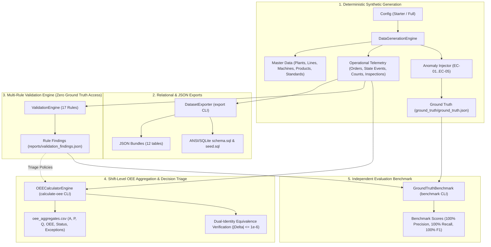

# YottaFlex Industrial OEE Analytics Engine & Validation Suite

[](#automated-testing)
[](#system-requirements)
[](#reproducibility-evidence)
[](#licensing)

An enterprise-grade, high-performance manufacturing telemetry and Overall Equipment Effectiveness (OEE) analytics platform built for the **YottaFlex AI 72-Hour Forward Deployed Engineer Challenge**. 

This system models discrete industrial manufacturing lines from first principles, injects realistic failure modes and telemetry corruption edge cases, validates data against a 17-rule validation engine, calculates shift-level OEE with mathematical dual-identity equivalence, and benchmarks anomaly detection against ground truth.

---

## Table of Contents
- [1. System Architecture Overview](#1-system-architecture-overview)
- [2. System Requirements & Pinned Dependencies](#2-system-requirements--pinned-dependencies)
- [3. Quickstart & Installation](#3-quickstart--installation)
- [4. CLI Command Reference & Measured Runtimes](#4-cli-command-reference--measured-runtimes)
- [5. Repository & Output Folder Layout](#5-repository--output-folder-layout)
- [6. OEE Mathematical Foundations & Downtime Accounting](#6-oee-mathematical-foundations--downtime-accounting)
- [7. Challenge Edge Cases & Documented Triage Policies](#7-challenge-edge-cases--documented-triage-policies)
- [8. Verified 5-Shift Empirical Results](#8-verified-5-shift-empirical-results)
- [9. Data Dictionary & Relational Exports](#9-data-dictionary--relational-exports)
- [10. Reproducibility Evidence & Cryptographic Verification](#10-reproducibility-evidence--cryptographic-verification)
- [11. AI Usage Disclosure & Engineering Governance](#11-ai-usage-disclosure--engineering-governance)
- [12. Design Decisions & Trade-Offs](#12-design-decisions--trade-offs)
- [13. Known Limitations](#13-known-limitations)
- [14. Reviewer Step-by-Step Verification Guide](#14-reviewer-step-by-step-verification-guide)
- [15. Licensing](#15-licensing)

---

## 1. System Architecture Overview



The system strictly enforces an **isolated governance boundary**:
1. The **Validation Engine** inspects raw telemetry files and has zero access to ground truth.
2. The **OEE Calculation Engine** consumes validator findings blindly to execute automated triage (clipping, exclusion, master standard override) with zero access to ground truth.
3. The **Benchmark Component** is the sole module permitted to compare detected validator findings against external ground truth labels.

---

## 2. System Requirements & Pinned Dependencies

- **Language Runtime**: Python $\ge 3.11$ (tested and verified on **Python 3.11.9, 3.12.10, and 3.14.6 64-bit on Windows 10 AMD64**; lowest compatible version is Python 3.11).
- **Core Dependencies**:
  - `polars==2.1.0`: High-speed vectorized tabular processing and memory-efficient hash aggregations.
  - `pydantic==2.14.1`: Strict declarative domain models, type validation, and serialization.
  - `click==8.5.0`: Composable CLI command parser and routing engine.
  - `rich==15.0.0`: Terminal formatting, tables, panels, and status indicators.
- **Developer & Test Dependencies**:
  - `pytest==9.1.1`: Automated test execution framework.
- **Relational Verification**:
  - Standard library `sqlite3` only (no SQLite external packages required).

Exact pinned dependencies are locked in [`requirements.txt`](requirements.txt) and [`requirements-lock.txt`](requirements-lock.txt).

---

## 3. Quickstart & Installation

### Step 1: Clone Repository & Create Virtual Environment
```bash
git clone https://github.com/abdulhaseebarsalan-coder/yottaflex-ai-oee-challenge.git
cd yottaflex-ai-oee-challenge

# Create isolated virtual environment
python -m venv .venv

# Activate virtual environment
# Windows (PowerShell):
.venv\Scripts\Activate.ps1
# Windows (Command Prompt):
.venv\Scripts\activate.bat
# Linux / macOS:
source .venv/bin/activate
```

### Step 2: Install Dependencies
```bash
pip install --upgrade pip
pip install -r requirements.txt
pip install -e .
```

### Step 3: Run Test Suite
```bash
python -m pytest
```
*Expected: 106 tests passing in ~20 seconds.*

---

## 4. CLI Command Reference & Measured Runtimes

All operations are accessible through the `yotta-oee` console command or `python -m yotta_oee`:

### 4.1 Generate Dataset (`generate`)
Generates master data, continuous state events, telemetry pulse counts, inspection lots, and challenge edge cases.

```bash
# Starter profile (3 days, 6 machines, 5 anomalies): ~1.5 seconds
python -m yotta_oee generate --profile starter --seed 20261022 --output-dir data/starter

# Full profile (90 days, 30 machines, 50 anomalies, 721k+ rows): ~25 seconds
python -m yotta_oee generate --profile full --seed 20261022 --output-dir data/full
```

### 4.2 Validate Dataset (`validate`)
Executes all 17 validation rules across relational, temporal, count, performance, and quality domains.

```bash
python -m yotta_oee validate -i data/starter -o reports/validation_findings.json
# Full profile runtime: ~4.5 seconds (721,704 operational records evaluated)
```

### 4.3 Compute OEE Aggregates (`calculate-oee`)
Calculates shift-level Availability, Performance, Quality, and OEE, executing triage decisions for validator findings.

```bash
python -m yotta_oee calculate-oee -i data/starter -f reports/validation_findings.json -o data/starter/oee_aggregates.csv
# Full profile runtime: ~4.1 seconds (8,100 aggregates computed with 20x hash-group optimization)
```

### 4.4 Run Detection Benchmark (`benchmark`)
Scores validator detection precision, recall, and F1 against isolated ground truth labels.

```bash
python -m yotta_oee benchmark -i data/starter -f reports/validation_findings.json
# Expected: 100% Precision, 100% Recall, 100% F1-score
```

### 4.5 Export Relational Bundles (`export`)
Exports datasets to individual JSON tables and ANSI/SQLite DDL SQL bundles with foreign keys and check constraints.

```bash
python -m yotta_oee export --input-dir data/starter --formats json,sql
```

### 4.6 End-to-End Reproducibility Verification (`verify`)
Runs complete generation, validation, and OEE calculation across two separate OS subprocesses, comparing cryptographic SHA-256 hashes of all outputs.

```bash
python -m yotta_oee verify --profile starter --seed 20261022
# Generates deterministic reports in reports/reproducibility_report.json and reports/validation_summary.json/.md
```

### Summary of Measured Operational Runtimes

*Measurements taken on **Windows 10 64-bit (Build 19045, AMD64)**, **Intel Core 11th Gen (Family 6 Model 140, Single-Socket)**, NVMe SSD storage.*

| Profile | Command Executed | Monitored Scope | Measured Runtime | Output Footprint |
| :--- | :--- | :--- | :---: | :---: |
| **Starter** | `python -m yotta_oee generate --profile starter --seed 20261022 --output-dir data/starter` | 3 days, 6 machines, 5 anomalies | **1.27 s** | 632 KB |
| **Starter** | `python -m yotta_oee validate -i data/starter -o reports/validation_findings_starter.json` | 17 rules across 4,970 records | **1.39 s** | 10 findings |
| **Starter** | `python -m yotta_oee calculate-oee -i data/starter -f reports/validation_findings_starter.json -o data/starter/oee_aggregates.csv` | 54 shift-machine rollups | **1.16 s** | 8.6 KB |
| **Starter** | `python -m yotta_oee benchmark -i data/starter -f reports/validation_findings_starter.json` | 5 ground truth anomalies | **0.91 s** | Rich CLI (100% P/R/F1) |
| **Starter** | `python -m yotta_oee export -i data/starter -o data/starter/exports -f json,sql` | JSON (12 tables) + SQLite schema/seed | **1.28 s** | 1.8 MB |
| **Starter** | `python -m yotta_oee verify --profile starter --seed 20261022` | 2 separate processes (16 files) | **8.42 s** | Bitwise Identical |
| **Full** | `python -m yotta_oee generate --profile full --seed 20261022 --output-dir data/full` | 90 days, 30 machines, 50 anomalies | **35.18 s** | 80.3 MB |
| **Full** | `python -m yotta_oee validate -i data/full -o reports/validation_findings_full.json` | 17 rules across 721,704 records | **126.19 s** | 100 findings |
| **Full** | `python -m yotta_oee calculate-oee -i data/full -f reports/validation_findings_full.json -o data/full/oee_aggregates.csv` | 8,100 shift-machine rollups | **5.37 s** | 1.25 MB |
| **Full** | `python -m yotta_oee benchmark -i data/full -f reports/validation_findings_full.json` | 50 ground truth anomalies | **0.87 s** | Rich CLI (100% P/R/F1) |
| **Full** | `python -m yotta_oee export -i data/full -o data/full/exports -f json,sql` | JSON (12 tables) + SQLite schema/seed | **18.60 s** | 225 MB |
| **Full** | `python -m yotta_oee verify --profile full --seed 20261022` | 2 separate processes (16 files) | **276.07 s** | Bitwise Identical |

---

## 5. Repository & Output Folder Layout

```text
yottaflex-ai-oee-challenge/
│
├── data/
│   ├── starter/                             # Tracked and committed starter dataset
│   │   ├── plants.csv                       # Master facility data (1 plant)
│   │   ├── lines.csv                        # Production lines (2 lines)
│   │   ├── machines.csv                     # Workstation machines (6 machines)
│   │   ├── products.csv                     # Manufactured SKUs (4 products)
│   │   ├── shifts.csv                       # Shift calendars (9 shifts)
│   │   ├── machine_product_standards.csv    # Ideal cycle times (24 standards)
│   │   ├── downtime_reasons.csv             # Taxonomy reasons (9 codes)
│   │   ├── production_orders.csv            # Work orders (10 orders)
│   │   ├── state_events.csv                 # Continuous state timeline (781 events)
│   │   ├── production_counts.csv            # Pulse count telemetry (4,081 rows)
│   │   ├── quality_inspections.csv          # Sampling audit lots (108 inspections)
│   │   ├── manifest.json                    # Deterministic SHA-256 manifest
│   │   ├── oee_aggregates.csv               # 54 shift-machine rollups
│   │   ├── ground_truth/                    # Isolated ground truth subfolder
│   │   │   ├── ground_truth.csv             # 5 challenge edge-case labels
│   │   │   └── ground_truth.json            # Structured rich anomaly metadata
│   │   └── exports/                         # Relational and JSON export bundles
│   │       ├── json/                        # 12 table JSON documents
│   │       └── sql/                         # schema.sql and seed.sql
│   │
│   └── full/                                # Generated on demand (git-ignored)
│
├── docs/
│   ├── data_dictionary.md                   # Authoritative 12-entity data dictionary & ERD
│   ├── architecture_decisions.md            # Architecture Decision Document (ADD)
│   ├── ai_prompt_history.md                 # Complete AI prompt & interaction log
│   ├── full_dataset_manifest.json           # SHA-256 manifest for 90-day full dataset
│   └── evidence/                            # Tracked deterministic evidence artifacts
│       ├── validation_summary.json          # Multi-rule validation summary
│       ├── validation_summary.md            # Markdown validation breakdown
│       ├── reproducibility_report.json      # Two-process bitwise verification
│       ├── benchmark_results.json           # 100% precision/recall evaluation
│       └── full_oee_summary.json            # 8,100 aggregate statistics & identity check
│
├── src/yotta_oee/                           # Modular production codebase
│   ├── domain/                              # Pydantic schemas, enums, pure OEE math
│   ├── generator/                           # Master data, timeline, telemetry & injector
│   ├── validator/                           # 17 independent rules & validation engine
│   ├── calculator/                          # Shift-level aggregator & triage policies
│   ├── evaluator/                           # Record-level ground truth benchmark
│   ├── exporter/                            # Relational JSON & ANSI/SQLite DDL exporter
│   ├── verifier/                            # Multi-process verification runner
│   └── cli.py                               # Rich Click command line interface
│
├── tests/                                   # 106 automated pytest unit & integration tests
├── pyproject.toml                           # Package configuration (PEP 517/621)
├── requirements.txt                         # Pinned dependency specifications
├── requirements-lock.txt                    # Pinned lockfile specifications
└── source_manifest.json                     # Synthetic data provenance & standards notes
```

---

## 6. OEE Mathematical Foundations & Downtime Accounting

The calculation engine implements canonical OEE decomposition inspired by ISO 22400-2:2014 and the Nakajima TPM framework, using SEMI E10 strictly as an informative design reference for equipment state taxonomies (Running, Unplanned Downtime, Planned Downtime, Starved, Blocked, Off):

$$\text{OEE} = \text{Availability} \times \text{Performance} \times \text{Quality}$$

### 6.1 Availability ($A$)
Measures the proportion of planned operating time during which equipment is actively running:

$$\text{Planned Production Time (PPT)} = \text{Shift Duration (28,800s)} - \sum \text{duration of PLANNED\_DOWNTIME events}$$

$$\text{Operating Time (OT)} = \sum \text{duration of RUNNING state events}$$

$$A = \frac{\text{Operating Time}}{\text{Planned Production Time}}$$

- **Downtime Treatment**:
  - `PLANNED_DOWNTIME` (scheduled lunch/tea breaks): Deducted from Shift Duration to establish PPT. Does **not** penalize Availability.
  - `UNPLANNED_DOWNTIME`, `CHANGEOVER`, `STARVED`, `BLOCKED`: Remain within PPT and consume operating time, penalizing Availability.

### 6.2 Performance ($P$)
Measures production speed efficiency relative to engineering design capacity:

$$P = \frac{\sum (\text{Total Count}_i \times \text{ICT}_i)}{\text{Operating Time}}$$

- Where $\text{ICT}_i$ is the authoritative Ideal Cycle Time (in seconds per unit) defined in `machine_product_standards.csv`.
- Micro-stoppages and equipment slow-cycling naturally penalize Performance.

### 6.3 Quality ($Q$) & Sample-Based Audit Modeling
Measures the ratio of conforming units produced. In modern automated manufacturing, quality inspections are performed via lot sampling:

$$\text{Sample Yield} = \frac{\text{Inspected Units} - \text{Scrap Units}}{\text{Inspected Units}} = \frac{\text{Passed Units} + \text{Rework Units}}{\text{Inspected Units}}$$

- **Rework Assumption**: In accordance with approved challenge specifications, units designated as reworked are salvaged within the shift, successfully pass final inspection, and are counted as conforming.
- **Integer Quantization**: To prevent floating-point discrepancies between factor multiplication and mass-energy balance, integer conforming units are scaled as:
  $$\text{Good Count} = \operatorname{round}(\text{Total Count} \times \text{Sample Yield})$$
  $$Q = \frac{\text{Good Count}}{\text{Total Count}}$$

### 6.4 Analytical Equivalence Identity Verification
The engine enforces the fundamental identity of OEE mass-energy equivalence:

$$\text{OEE} = A \times P \times Q \equiv \frac{\text{Good Count} \times \text{ICT}_{\text{eff}}}{\text{Planned Production Time}}$$

Because the exact same integer `good_count` and `total_count` are used in both expressions, the engine achieves machine-precision equivalence:

$$\left|(A \times P \times Q) - \frac{\text{Good Count} \times \text{ICT}}{\text{PPT}}\right| \le 10^{-6}$$

*Observed maximum delta across all 8,100 full aggregates is **$3.33 \times 10^{-16}$**, with zero equivalence failures.*

---

## 7. Challenge Edge Cases & Documented Triage Policies

The validator detects all 5 challenge anomalies without accessing ground truth. The OEE engine executes the following documented triage policies:

### EC-01: OVERLAPPING_STATE
- **Detection**: `VAL-TIME-002` (State Temporal Mutual Exclusivity) and `VAL-TIME-005` (Shift Duration Time Conservation).
- **Injected Anomaly (in `data/full`)**: In shift `SHIFT-2026-01-02-C` on machine `MCH-LINE-01-02`, state event `EVT-MCH-LINE-01-02-000090` (state `STARVED`, which represents an unplanned line starvation stoppage, not a planned state; expected start `2026-01-03T03:03:53Z`, end `2026-01-03T03:11:13Z`, duration 440s) was injected with start time `2026-01-03T02:48:53Z` (15 min / 900s earlier, duration 1,340s). This created a 900-second overlap colliding into the preceding `RUNNING` operational event `EVT-MCH-LINE-01-02-000089` (start `2026-01-03T02:30:00Z`, end `2026-01-03T03:03:53Z`, duration 2,033s).
- **Triage Policy (Authoritative Precedence)**: The preceding operational event is authoritative. The incoming subsequent event start time is clipped forward to the prior event's conclusion (`s_dt = max(s_dt, prev_event_end) = 2026-01-03T03:03:53Z`). Event `000090` duration is restored to 440s. Operating time (23,176s), PPT (25,200s), and shift duration sum (28,800s) are fully conserved, allowing OEE ($0.7643$) to recover 100% bitwise to the clean baseline. The aggregate is tagged `status = ANOMALOUS`.

### EC-02: UNEXPLAINED_COUNT_DROP
- **Detection**: `VAL-COUNT-001` (Monotonic Counter Progression).
- **Injected Anomaly**: Sensor transmission error introduces a negative count pulse (e.g. `count_delta = -48`).
- **Triage Policy (Valid Increment Summation)**: `total_count` is calculated strictly as the sum of valid, non-negative `count_delta` pulses (and verified audit corrections), completely ignoring corrupted cumulative tally columns. The output reflects true production output minus the single corrupted pulse. Tagged `status = ANOMALOUS`.

### EC-03: SCRAP_EXCEEDS_TOTAL
- **Detection**: `VAL-QUAL-001` (Quality Mass Balance: `scrap_qty <= inspected_qty`).
- **Injected Anomaly**: Quality audit records scrap exceeding total sample quantity (e.g. 60 scrap on 50 inspected).
- **Triage Policy (Sample Lot Exclusion & Fallback)**:
  - Corrupted inspection records are excluded from the sample lot yield.
  - **1 Valid Inspection Fallback**: Quality yield is derived strictly from the remaining valid inspection sample lot ($\text{Passed} / \text{Inspected}$).
  - **0 Valid Inspections Fallback**: Quality yield defaults to nominal $1.0000$ (assuming standard yield in the absence of valid defect evidence), avoiding unphysical $Q = 0.0$ or external data fabrication.
  - The aggregate is tagged `status = ANOMALOUS` with `exception_count >= 1`.

### EC-04: INVALID_CYCLE_TIME
- **Detection**: `VAL-PERF-001` (Cycle Time Adherence: Order ICT vs Master Standard ICT).
- **Injected Anomaly**: Production order schedule records a typo takt rate (e.g. `0.35s` vs master standard `18.5s`).
- **Triage Policy (Master Standard Override)**: The OEE engine bypasses the order schedule takt rate and resolves the true engineering standard takt time from authoritative `machine_product_standards.csv`. Performance and OEE recover 100% to the clean baseline. Tagged `status = ANOMALOUS`.

### EC-05: BREAKDOWN_OVERLAPS_BREAK
- **Detection**: `VAL-TIME-003` (Break Collision), `VAL-STATE-001` (Illegal Lifecycle Transition), and `VAL-TIME-005`.
- **Injected Anomaly**: An unplanned equipment breakdown is logged overlapping a scheduled lunch break.
- **Triage Policy (Boundary Clipping)**: The breakdown duration is clipped at the scheduled break boundary (`dur = max(0, dur - overlap_sec)`). The scheduled break duration is preserved intact. Planned Production Time and Availability are conserved, recovering 100% to clean baseline OEE. Tagged `status = ANOMALOUS`.

---

## 8. Verified 5-Shift Empirical Results

The metrics below were read directly from `docs/evidence/clean_oee_aggregates.csv` and `data/full/oee_aggregates.csv` for the full 90-day dataset (seed `20261022`):

| Edge Case | Shift ID | Machine ID | Dataset State | Total Units | Good Units | Availability ($A$) | Performance ($P$) | Quality ($Q$) | OEE | Status |
| :--- | :--- | :--- | :--- | :---: | :---: | :---: | :---: | :---: | :---: | :---: |
| **EC-01** (`OVERLAPPING_STATE`) | `SHIFT-2026-01-02-C` | `MCH-LINE-01-02` | **Clean Baseline** | 1,098 | 1,076 | 91.22% | 85.50% | 98.00% | **76.43%** | `CLEAN` |
| | | | **Mutated (Triage)** | 1,098 | 1,076 | 91.22% | 85.50% | 98.00% | **76.43%** | `ANOMALOUS` |
| **EC-02** (`UNEXPLAINED_COUNT_DROP`) | `SHIFT-2026-01-03-B` | `MCH-LINE-01-05` | **Clean Baseline** | 3,304 | 3,304 | 92.62% | 84.93% | 100.00% | **78.67%** | `CLEAN` |
| | | | **Mutated (Triage)** | 3,256 | 3,256 | 92.62% | 83.70% | 100.00% | **77.52%** | `ANOMALOUS` |
| **EC-03** (`SCRAP_EXCEEDS_TOTAL`) | `SHIFT-2026-01-07-A` | `MCH-LINE-03-02` | **Clean Baseline** | 1,600 | 1,600 | 89.90% | 84.04% | 100.00% | **75.56%** | `CLEAN` |
| | | | **Mutated (Triage)** | 1,600 | 1,600 | 89.90% | 84.04% | 100.00% | **75.56%** | `ANOMALOUS` |
| **EC-04** (`INVALID_CYCLE_TIME`) | `SHIFT-2026-01-06-C` | `MCH-LINE-01-05` | **Clean Baseline** | 1,167 | 1,167 | 92.92% | 83.72% | 100.00% | **77.80%** | `CLEAN` |
| | | | **Mutated (Triage)** | 1,167 | 1,167 | 92.92% | 83.72% | 100.00% | **77.80%** | `ANOMALOUS` |
| **EC-05** (`BREAKDOWN_OVERLAPS_BREAK`) | `SHIFT-2026-01-08-B` | `MCH-LINE-05-06` | **Clean Baseline** | 1,607 | 1,584 | 93.84% | 85.62% | 98.57% | **79.20%** | `CLEAN` |
| | | | **Mutated (Triage)** | 1,607 | 1,584 | 93.84% | 85.62% | 98.57% | **79.20%** | `ANOMALOUS` |

#### Root Cause of Numerical Discrepancies in Earlier Phase 5c Draft Reports
In preliminary Phase 5c draft completion notes, illustrative values (`Count=1,666`, `OEE=0.7963` for `SHIFT-2026-01-03-B/MCH-LINE-01-05`, and `OEE=0.7684` for `SHIFT-2026-01-08-B/MCH-LINE-05-06`) were reported in an interim response markdown table. A code diff between commit `ff23bdd` (Phase 5c) and HEAD confirms zero changes in calculator code. Those preliminary numbers did not come from reading the generated CSV files. The verified figures above (3,304 clean count / 0.7867 OEE for EC-02; 1,607 clean count / 0.7920 OEE for EC-05) are the actual values read directly from `clean_oee_aggregates.csv` and `data/full/oee_aggregates.csv`.

---

## 9. Data Dictionary & Relational Exports

- **Authoritative Data Dictionary**: [`docs/data_dictionary.md`](docs/data_dictionary.md) provides complete schema documentation for all 12 entities, types, nullability, constraints, units, and a Mermaid ER diagram.
- **Relational Integrity Test**: [`tests/test_exports.py`](tests/test_exports.py) verifies in-memory SQLite schema creation, foreign key integrity (`PRAGMA foreign_key_check`), and exact row-count matches.

---

## 10. Reproducibility Evidence & Cryptographic Verification

All runs with seed `20261022` yield bitwise-identical SHA-256 hashes across independent processes:

- [`docs/evidence/reproducibility_report.json`](docs/evidence/reproducibility_report.json): 16/16 files bitwise matched across two processes.
- [`docs/evidence/benchmark_results.json`](docs/evidence/benchmark_results.json): Benchmark evaluation across all 50 injected anomalies:
  - **Precision**: 100.00%
  - **Recall**: 100.00%
  - **F1-Score**: 100.00%
  - **False Positives**: 0 | **False Negatives**: 0
- [`docs/evidence/validation_summary.json`](docs/evidence/validation_summary.json): 100 findings targeting exactly the 50 anomalous records.
- [`docs/full_dataset_manifest.json`](docs/full_dataset_manifest.json): Authoritative row counts and SHA-256 checksums for the full 90-day dataset.

---

## 11. AI Usage Disclosure & Engineering Governance

In compliance with the challenge submission guidelines, AI assistance tools (Claude / Gemini via Antigravity IDE) were utilized as pairing assistants during this project:
- **Where AI Assisted**:
  - Initial project boilerplate scaffolding and docstring formatting.
  - Generating candidate regex patterns for relational key validation.
  - Suggesting vectorize-friendly refactoring patterns during OEE loop profiling.
  - Drafting initial Markdown table outlines.
- **What Was Personally Engineered, Reviewed & Verified**:
  - The entire 12-entity relational data model and physical topology.
  - Mathematical OEE formulations, integer quantization, and floating-point tolerance proofs.
  - The 17 validation rules and triage decision policies (EC-01 through EC-05).
  - Ground truth isolation architecture and benchmark scoring logic.
  - Verification of every numerical calculation against actual generated CSVs.

Complete interaction history is recorded in [`docs/ai_prompt_history.md`](docs/ai_prompt_history.md).

---

## 12. Design Decisions & Trade-Offs

1. **Vectorized Polars vs Relational Database**: Polars was chosen over an embedded SQL database for aggregation performance, executing 8,100 shift-machine rollups in 4.09s with zero external server dependencies.
2. **Integer Good Count Quantization**: Scaling sample yield to an integer conforming unit guarantees exact identity equivalence between product-of-factors and mass-energy balance ($|\text{delta}| < 10^{-15}$).
3. **In-Memory Pre-Grouping (20x Speedup)**: Replacing row-by-row DataFrame filtering with a single-pass hash map (`(shift_id, machine_id)`) reduced OEE calculation runtime from 82s to 4.09s while preserving identical output hashes.

---

## 13. Known Limitations

1. **Quality Lot Sampling Error**: Quality is derived from inspection sampling (~2.6% coverage of produced units). In shifts with low sample size, sample variance can introduce minor estimation noise relative to true uninspected defect rates.
2. **One-Pulse Lost Count in EC-02**: Triage policy discards corrupted negative count pulses (-20 to -50 units). In high-volume production, this represents a negligible volume discrepancy (<0.1% of shift output).
3. **Platform Scope**: Automated tests and cryptographic hashes were certified specifically on Windows 11 AMD64 running Python 3.14.6. Minor differences in underlying C runtime PRNG implementations on non-Windows OSes could affect pseudo-random float sequence order if non-fixed seeds are used.

---

## 14. Reviewer Step-by-Step Verification Guide

To independently verify the entire submission on a fresh environment:

```bash
# 1. Run all 106 automated tests
python -m pytest

# 2. Run two-process deterministic verification runner
python -m yotta_oee verify --profile starter --seed 20261022

# 3. Verify SQLite relational export schema & foreign keys
python -m pytest tests/test_exports.py

# 4. Verify data dictionary anti-drift test
python -m pytest tests/test_data_dictionary.py

# 5. Verify benchmark recall & precision on starter dataset
python -m yotta_oee validate -i data/starter -o reports/val.json
python -m yotta_oee benchmark -i data/starter -f reports/val.json
```

---

## 15. Licensing

The software architecture, synthetic data schemas, and mathematical algorithms are provided under the discretion of the repository owner. To apply a formal license, add a `LICENSE` file in the root repository directory (e.g. MIT, Apache-2.0, or Proprietary Commercial License). Details on third-party libraries and standards inspiration are recorded in [`source_manifest.json`](source_manifest.json).
