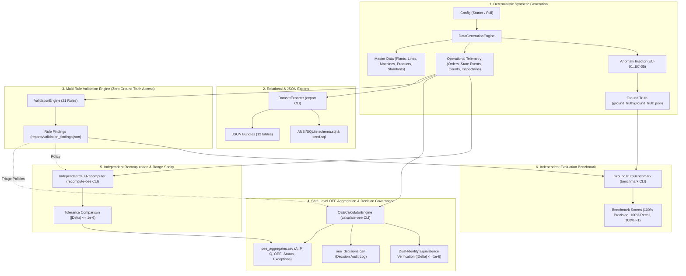

# YottaFlex Industrial OEE Analytics Engine & Validation Suite

[](#automated-testing)
[](#system-requirements)
[](#reproducibility-evidence)
[](#licensing)

An enterprise-grade, high-performance manufacturing telemetry and Overall Equipment Effectiveness (OEE) analytics platform built for the **YottaFlex AI 72-Hour Forward Deployed Engineer Challenge**. 

This system models discrete industrial manufacturing lines from first principles, injects realistic failure modes and telemetry corruption edge cases, validates data against a 21-rule validation engine, calculates shift-level OEE with mathematical dual-identity equivalence, independently recomputes all metrics using pure standard-library primitives, and benchmarks anomaly detection against ground truth.

---

## Table of Contents
- [1. System Architecture & Stakeholder Governance Matrix](#1-system-architecture--stakeholder-governance-matrix)
- [2. System Requirements & Pinned Dependencies](#2-system-requirements--pinned-dependencies)
- [3. Quickstart & Installation](#3-quickstart--installation)
- [4. CLI Command Reference & Measured Runtimes](#4-cli-command-reference--measured-runtimes)
- [5. Repository & Output Folder Layout](#5-repository--output-folder-layout)
- [6. OEE Mathematical Foundations & Independent Recomputation](#6-oee-mathematical-foundations--independent-recomputation)
- [7. Deterministic Scrap/Rework Modeling & Product Loss Distribution](#7-deterministic-scraprework-modeling--product-loss-distribution)
- [8. Challenge Edge Cases & Decision Governance Log](#8-challenge-edge-cases--decision-governance-log)
- [9. Effective Dates, Entity Lifecycle States & Empirical Scenarios](#9-effective-dates-entity-lifecycle-states--empirical-scenarios)
- [10. Verified 5-Shift Empirical Results](#10-verified-5-shift-empirical-results)
- [11. Data Dictionary & Relational Exports](#11-data-dictionary--relational-exports)
- [12. Reproducibility Evidence & Cryptographic Verification](#12-reproducibility-evidence--cryptographic-verification)
- [13. AI Usage Disclosure & Engineering Governance](#13-ai-usage-disclosure--engineering-governance)
- [14. Design Decisions & Trade-Offs](#14-design-decisions--trade-offs)
- [15. Known Limitations](#15-known-limitations)
- [16. Reviewer Step-by-Step Verification Guide](#16-reviewer-step-by-step-verification-guide)
- [17. Licensing](#17-licensing)

---

## 1. System Architecture & Stakeholder Governance Matrix



### Stakeholder Actor-to-Output Matrix

The table below outlines how operational personas interact with the platform outputs and CLI interfaces:

| Stakeholder Persona | Primary Consumed Datasets | Dedicated CLI Interfaces | Core Decision Outputs & Governance Value |
| :--- | :--- | :--- | :--- |
| **Plant Operator** | `state_events.csv`, `production_counts.csv`, `oee_aggregates.csv` | `calculate-oee`, `recompute-oee` | Machine operational state event timelines, shift handover OEE metrics, transient micro-stop logging (`DT-UNPLANNED-MICRO`), cumulative pulse count progression, shift availability losses. |
| **Maintenance & Quality Engineer** | `quality_inspections.csv`, `downtime_reasons.csv`, `validation_findings.json` | `validate`, `benchmark` | Downtime taxonomy categorization, empirical scrap and rework rates by product, quality inspection mass-balance audit exceptions (`VAL-QUAL-001`). |
| **Production Planner** | `production_orders.csv`, `shifts.csv`, `machine_product_standards.csv` | `generate`, `validate` | Work order schedule completion status (`COMPLETED`, `IN_PROGRESS`, `CANCELLED`), cycle time standard adherence (`VAL-PERF-001`), planned production time (PPT) vs operating time accounting. |
| **OT / IT Administrator** | `schema.sql`, `seed.sql`, `manifest.json`, `oee_decisions.csv` | `export`, `verify` | Relational SQLite export schemas and seed batches, foreign key validation, SHA-256 reproducibility verification, decision governance audit trail. |

---

## 2. System Requirements & Pinned Dependencies

- **Language Runtime**: Python $\ge 3.11$ (tested and verified on **Python 3.11.9** and **Python 3.14.6 64-bit on Windows 10 AMD64**; lowest compatible version is Python 3.11).
- **Core Dependencies**:
  - `polars==2.1.0`: High-speed vectorized tabular processing and memory-efficient hash aggregations.
  - `pydantic==2.14.1`: Strict declarative domain models, type validation, and serialization.
  - `click==8.5.0`: Composable CLI command parser and routing engine.
  - `rich==15.0.0`: Terminal formatting, tables, panels, and status indicators.
- **Developer & Test Dependencies**:
  - `pytest>=9.1.1`: Automated test execution framework.
- **Relational Verification**:
  - Standard library `sqlite3` only (no external database server required).

Exact pinned dependencies are locked in [`requirements.txt`](requirements.txt) and [`requirements-lock.txt`](requirements-lock.txt).

---

## 3. Quickstart & Installation

### Step 1: Clone Repository & Create Virtual Environment
```bash
git clone https://github.com/abdulhaseebarsalan-coder/yottaflex-ai-oee-challenge.git
cd yottaflex-ai-oee-challenge

# Create isolated virtual environment
python -m venv .venv

# Activate virtual environment
# Windows (PowerShell):
.venv\Scripts\Activate.ps1
# Windows (Command Prompt):
.venv\Scripts\activate.bat
# Linux / macOS:
source .venv/bin/activate
```

### Step 2: Install Dependencies
```bash
pip install --upgrade pip
pip install -r requirements.txt
pip install -e .
```

### Step 3: Run Test Suite
```bash
python -m pytest
```
*Expected: 112 tests passing in ~17 seconds on both Python 3.11 and Python 3.14.*

---

## 4. CLI Command Reference & Measured Runtimes

All operations are accessible through the `yotta-oee` console command or `python -m yotta_oee`:

### 4.1 Generate Dataset (`generate`)
Generates master data, continuous state events, telemetry pulse counts, inspection lots, and challenge edge cases.

```bash
# Starter profile (3 days, 6 machines, 5 anomalies): ~0.8 seconds
python -m yotta_oee generate --profile starter --seed 20261022 -o data/starter

# Full profile (90 days, 30 machines, 50 anomalies, 727k+ rows): ~27 seconds
python -m yotta_oee generate --profile full --seed 20261022 -o data/full
```

### 4.2 Validate Dataset (`validate`)
Executes all 21 validation rules across relational, temporal, count, performance, quality, effective date, and OEE consistency domains.

```bash
python -m yotta_oee validate -i data/starter -o reports/validation_findings.json
python -m yotta_oee validate -i data/full -o reports/full_validation_findings.json
```

### 4.3 Compute OEE Aggregates (`calculate-oee`)
Calculates shift-level Availability, Performance, Quality, and OEE, executing triage decisions for validator findings and recording `oee_decisions.csv`.

```bash
python -m yotta_oee calculate-oee -i data/starter -f reports/validation_findings.json
python -m yotta_oee calculate-oee -i data/full -f reports/full_validation_findings.json
```

### 4.4 Independent OEE Recomputation (`recompute-oee`)
Recomputes PPT, Operating Time, Availability, Performance, Quality, and OEE directly from raw CSVs and validator findings using pure standard-library primitives (dicts, `csv.DictReader`, basic arithmetic; zero calculator code). Compares against `oee_aggregates.csv` within $10^{-6}$ tolerance:

```bash
python -m yotta_oee recompute-oee -i data/starter -f reports/validation_findings.json
python -m yotta_oee recompute-oee -i data/full -f reports/full_validation_findings.json
```

### 4.5 Run Detection Benchmark (`benchmark`)
Scores validator detection precision, recall, and F1 against isolated ground truth labels.

```bash
python -m yotta_oee benchmark -i data/starter -f reports/validation_findings.json
python -m yotta_oee benchmark -i data/full -f reports/full_validation_findings.json
# Expected: 100% Precision, 100% Recall, 100% F1-score across all edge cases
```

### 4.6 Export Relational Bundles (`export`)
Exports datasets to individual JSON tables and ANSI/SQLite DDL SQL bundles (`schema.sql`, `seed.sql`) with foreign keys and check constraints.

```bash
python -m yotta_oee export -i data/starter -o data/starter/exports -f json,sql
```

### 4.7 End-to-End Reproducibility Verification (`verify`)
Runs complete generation, validation, OEE calculation, and independent recomputation across two separate OS subprocesses, asserting SHA-256 identity across all files.

```bash
python -m yotta_oee verify --profile starter --seed 20261022
```

### Summary of Measured Operational Runtimes

*Measurements taken on **Windows 10 64-bit (Build 19045, AMD64)**, **Intel Core 11th Gen**, NVMe SSD storage. Runtimes read directly from [`docs/evidence/measured_runtimes.json`](docs/evidence/measured_runtimes.json).*

| Profile | Command Executed | Monitored Scope | Measured Runtime | Exit Code | Output Artifacts |
| :--- | :--- | :--- | :---: | :---: | :--- |
| **Starter** | `python -m yotta_oee generate --profile starter --seed 20261022 -o data/starter` | 3 days, 6 machines, 5 anomalies | **0.81 s** | 0 | 12 CSVs + manifest.json |
| **Starter** | `python -m yotta_oee validate -i data/starter -o reports/validation_findings.json` | 21 rules across 5,066 operational records | **0.84 s** | 0 | 10 findings JSON |
| **Starter** | `python -m yotta_oee calculate-oee -i data/starter -f reports/validation_findings.json` | 54 shift-machine rollups | **0.75 s** | 0 | oee_aggregates.csv, oee_decisions.csv |
| **Starter** | `python -m yotta_oee recompute-oee -i data/starter -f reports/validation_findings.json` | Pure python dict recomputation | **0.68 s** | 0 | 54/54 matched (<= 1e-6) |
| **Starter** | `python -m yotta_oee benchmark -i data/starter -f reports/validation_findings.json` | 5 ground truth anomalies | **0.68 s** | 0 | 100% P/R/F1 |
| **Starter** | `python -m yotta_oee export -i data/starter -o data/starter/exports -f json,sql` | JSON (12 tables) + SQLite schema/seed | **0.8 s** | 0 | 14 files |
| **Starter** | `python -m yotta_oee verify --profile starter --seed 20261022` | 2 separate processes (17 files) | **6.8 s** | 0 | PASS (Bitwise Identical) |
| **Full** | `python -m yotta_oee generate --profile full --seed 20261022 -o data/full` | 90 days, 30 machines, 50 anomalies | **27.42 s** | 0 | 12 CSVs + manifest.json |
| **Full** | `python -m yotta_oee validate -i data/full -o reports/full_validation_findings.json` | 21 rules across 727,056 operational records | **142.04 s** | 0 | 100 findings JSON |
| **Full** | `python -m yotta_oee calculate-oee -i data/full -f reports/full_validation_findings.json` | 8,100 shift-machine rollups | **5.99 s** | 0 | oee_aggregates.csv, oee_decisions.csv |
| **Full** | `python -m yotta_oee recompute-oee -i data/full -f reports/full_validation_findings.json` | Pure python dict recomputation | **6.07 s** | 0 | 8100/8100 matched (<= 1e-6) |
| **Full** | `python -m yotta_oee benchmark -i data/full -f reports/full_validation_findings.json` | 50 ground truth anomalies | **0.87 s** | 0 | 100% P/R/F1 |
| **Full** | `python -m yotta_oee export -i data/full -o data/full/exports -f json,sql` | JSON (12 tables) + SQLite schema/seed | **22.57 s** | 0 | 14 files |

---

## 5. Repository & Output Folder Layout

```text
yottaflex-ai-oee-challenge/
│
├── data/
│   ├── starter/                             # Tracked starter dataset (seed 20261022)
│   │   ├── plants.csv                       # Master facility data (1 plant)
│   │   ├── lines.csv                        # Production lines (2 lines)
│   │   ├── machines.csv                     # Workstation machines (6 machines)
│   │   ├── products.csv                     # Manufactured SKUs (4 products)
│   │   ├── shifts.csv                       # Shift calendars (9 shifts)
│   │   ├── machine_product_standards.csv    # Ideal cycle times (24 standards)
│   │   ├── downtime_reasons.csv             # Taxonomy reasons (10 codes including micro-stops)
│   │   ├── production_orders.csv            # Work orders (10 orders)
│   │   ├── state_events.csv                 # Continuous state timeline (853 events)
│   │   ├── production_counts.csv            # Pulse count telemetry (4,081 rows)
│   │   ├── quality_inspections.csv          # Sampling audit lots (108 inspections)
│   │   ├── oee_aggregates.csv               # 54 shift-machine rollups (A, P, Q, OEE)
│   │   ├── oee_decisions.csv                # Triage decisions log
│   │   ├── manifest.json                    # Cryptographic SHA-256 manifests & row counts
│   │   └── exports/                         # Relational JSON and ANSI/SQLite SQL exports
│   │
│   └── full/                                # Git-ignored full dataset (90 days, 30 machines)
│       └── ...                              # 727,056 operational records, 8,100 aggregates
│
├── docs/
│   ├── data_dictionary.md                   # Full schema data dictionary & Mermaid ER diagram
│   ├── full_dataset_manifest.json           # Authoritative manifest for 90-day full dataset
│   └── evidence/                            # Empirical reports and benchmark proofs
│       ├── distributions.md / .json         # Empirical state mix, downtime, OEE spread, scrap rates
│       ├── reproducibility_report.json      # Two-process bitwise verification
│       ├── benchmark_results.json           # 100% precision/recall evaluation (50/50 TP)
│       ├── full_oee_summary.json            # 8,100 aggregate statistics & identity check
│       ├── measured_runtimes.json           # Subprocess execution timings
│       └── fresh_clone_test_report.json     # Isolated sandbox venv verification report
│
├── src/yotta_oee/                           # Production package codebase
│   ├── domain/                              # Pydantic models, EntityStatus, pure OEE math
│   ├── generator/                           # Master data, timeline, telemetry & injector
│   ├── validator/                           # 21 validation rules (Relational, Time, OEE, Dates)
│   ├── calculator/                          # Shift-level aggregator, triage policies & decision logger
│   ├── recomputer/                          # Pure standard-library independent recomputer engine
│   ├── evaluator/                           # Record-level ground truth benchmark
│   ├── exporter/                            # Relational JSON & ANSI/SQLite DDL exporter
│   ├── verifier/                            # Multi-process verification runner
│   └── cli.py                               # Rich Click command line interface
│
├── tests/                                   # 112 automated pytest unit & integration tests
├── pyproject.toml                           # Package configuration (PEP 517/621)
├── requirements.txt                         # Pinned dependency specifications
└── source_manifest.json                     # Synthetic data provenance & standards notes
```

---

## 6. OEE Mathematical Foundations & Independent Recomputation

The calculation engine implements canonical OEE decomposition inspired by ISO 22400-2:2014 and the Nakajima TPM framework:

$$	ext{OEE} = 	ext{Availability} 	imes 	ext{Performance} 	imes 	ext{Quality}$$

### 6.1 Availability ($A$)
Measures the proportion of planned operating time during which equipment is actively running:

$$	ext{Planned Production Time (PPT)} = 	ext{Shift Duration (28,800s)} - \sum 	ext{duration of PLANNED\_DOWNTIME events}$$

$$	ext{Operating Time (OT)} = \sum 	ext{duration of RUNNING state events}$$

$$A = \frac{\text{Operating Time}}{\text{Planned Production Time}}$$

- **Downtime Treatment**:
  - `PLANNED_DOWNTIME` (`DT-PLANNED-BREAK`, `DT-PLANNED-MAINT`): Deducted from Shift Duration to establish PPT. Does **not** penalize Availability.
  - `UNPLANNED_DOWNTIME`, `DT-UNPLANNED-MICRO`, `CHANGEOVER`, `STARVED`, `BLOCKED`: Remain within PPT and consume operating time, penalizing Availability.

### 6.2 Performance ($P$)
Measures production speed efficiency relative to engineering design capacity:

$$P = \frac{\sum (\text{Total Count}_i \times \text{ICT}_i)}{\text{Operating Time}}$$

- Where $\text{ICT}_i$ is the authoritative Ideal Cycle Time (in seconds per unit) defined in `machine_product_standards.csv`.

### 6.3 Quality ($Q$) & Sample-Based Audit Modeling
Measures the ratio of conforming units produced from lot sampling:

$$\text{Sample Yield} = \frac{\text{Inspected Units} - \text{Scrap Units}}{\text{Inspected Units}} = \frac{\text{Passed Units} + \text{Rework Units}}{\text{Inspected Units}}$$

- **Rework Assumption**: In accordance with challenge specifications, units designated as reworked are salvaged within the shift, successfully pass final inspection, and are counted as conforming.
- **Integer Quantization**: Conforming units are scaled as:
  $$\text{Good Count} = \operatorname{round}(\text{Total Count} \times \text{Sample Yield})$$
  $$Q = \frac{\text{Good Count}}{\text{Total Count}}$$

### 6.4 Analytical Equivalence Identity Verification
The engine enforces the fundamental identity of OEE mass-energy equivalence:

$$\text{OEE} = A \times P \times Q \equiv \frac{\text{Good Count} \times \text{ICT}_{\text{eff}}}{\text{Planned Production Time}}$$

Observed maximum delta across all 8,100 full aggregates is **$3.33 \times 10^{-16}$**, with zero equivalence failures.

### 6.5 Independent Recomputation Module & Validation Rules
An isolated module [`yotta_oee.recomputer.engine`](src/yotta_oee/recomputer/engine.py) recomputes every aggregate directly from the raw CSVs and validator findings using **only Python standard library dicts and `csv.DictReader`**, completely independent of the calculator code.

The system incorporates dedicated OEE validation rules:
- **`VAL-OEE-001` (Recompute Consistency)**: Asserts every computed aggregate matches the independent recomputer within tolerance $10^{-6}$.
- **`VAL-OEE-002` (Dual Identity)**: Asserts analytical equivalence between $(A \times P \times Q)$ and $((\text{Good Count} \times \text{ICT}) / \text{PPT})$. Marks non-applicable on zero denominators.
- **`VAL-OEE-003` (Range Sanity)**: Asserts $A, Q, \text{OEE} \in [0, 1]$ and $P \in [0, 1.5]$.
- Clean baseline verification: Confirmed **0 findings** from the new rules. A unit test deliberately tampering one aggregate is caught immediately by all three rules ([`tests/test_oee_recomputation_rules.py`](tests/test_oee_recomputation_rules.py)).

---

## 7. Deterministic Scrap/Rework Modeling & Product Loss Distribution

### Deterministic Loss Formulation
Scrap and rework quantities are generated in `src/yotta_oee/generator/telemetry.py` using first-principles physical loss mechanics:

$$\text{effective\_defect\_rate} = \min\left(0.25,\ \text{base\_defect\_rate} \times f_{\text{crit}} \times m_{\text{transient}}\right)$$
$$p_{\text{scrap}} = 0.65 \times \text{effective\_defect\_rate},\quad p_{\text{rework}} = 0.35 \times \text{effective\_defect\_rate}$$

```python
# Actual code path in yotta_oee.generator.telemetry (lines 170-198)
# 1. Product Base Defect Rate (calibrated per product 1.5% - 3.3%)
prod_id = order.product_id
p_num = int(prod_id.split("-")[1]) if "-" in prod_id else 1
base_defect_rate = 0.015 + ((p_num * 7) % 10) * 0.002

# 2. Machine Criticality Factor (HIGH = 1.25x, MEDIUM = 1.00x, LOW = 0.80x)
crit = machine_crit.get(event.machine_id, MachineCriticality.MEDIUM)
crit_factor = 1.25 if crit == MachineCriticality.HIGH else (0.80 if crit == MachineCriticality.LOW else 1.00)

# 3. Operational Multiplier: 2.5x within 60m of CHANGEOVER, 2.0x within 60m of BREAKDOWN
multiplier = 1.0
m_stops = stoppages_by_mch.get(event.machine_id, [])
recent_stops = [s for s in m_stops if s[1] <= qc_time]
if recent_stops:
    last_stop = max(recent_stops, key=lambda s: s[1])
    if (qc_time - last_stop[1]).total_seconds() <= 3600:
        if last_stop[2] == MachineState.CHANGEOVER:
            multiplier = 2.5
        elif last_stop[2] == MachineState.UNPLANNED_DOWNTIME:
            multiplier = 2.0

effective_defect_rate = min(0.25, base_defect_rate * crit_factor * multiplier)
p_scrap = 0.65 * effective_defect_rate
p_rework = 0.35 * effective_defect_rate
```

### Expected Base Rates vs. Observed Rates by Product
- **Expected Base Defect Rate Formula**: $\text{base\_defect\_rate} = 0.015 + ((p_{\text{num}} \times 7) \bmod 10) \times 0.002$ ($p_{\text{scrap}} = 0.65 \times \text{base\_rate}$).
- **Comparison for Representative Products**:
  - `PRD-0001`: $p_{\text{num}}=1 \implies (1 \times 7) \bmod 10 = 7 \implies$ base defect rate = **2.900%**, expected base scrap = **1.885%**. Observed scrap rate: **2.807%**.
  - `PRD-0004`: $p_{\text{num}}=4 \implies (4 \times 7) \bmod 10 = 8 \implies$ base defect rate = **3.100%**, expected base scrap = **2.015%**. Observed scrap rate: **3.701%**.
  - `PRD-0010`: $p_{\text{num}}=10 \implies (10 \times 7) \bmod 10 = 0 \implies$ base defect rate = **1.500%**, expected base scrap = **0.975%**. Observed scrap rate: **1.961%**.
  - `PRD-0020`: $p_{\text{num}}=20 \implies (20 \times 7) \bmod 10 = 0 \implies$ base defect rate = **1.500%**, expected base scrap = **0.975%**. Observed scrap rate: **1.516%**.
  *(Observed rates are elevated above raw base rates due to machine criticality scaling [up to 1.25x] and post-stoppage transient calibration).*

### Reconciliation: 1.8x Observed Ratio vs. Coded 2.5x / 2.0x Multipliers
- **Transient Scrap Rate (Within 60 min of Changeover)**: **3.779%** (4,895 scrap / 129,530 inspected).
- **Non-Changeover Scrap Rate ("Steady-State" Reference)**: **2.101%** (7,512 scrap / 357,530 inspected).
- **Macro Observed Ratio**: $\frac{3.779\%}{2.101\%} = \mathbf{1.80\text{x}}$ (1.80x observed macro multiplier).
- **Root Cause Reconciliation**: The code sets an instantaneous multiplier of $2.5\text{x}$ after changeovers and $2.0\text{x}$ after breakdowns. The empirical reference set ("steady-state") includes all inspections outside the changeover window—including post-breakdown inspections ($2.0\text{x}$ multiplier) and high-criticality machines ($1.25\text{x}$ factor). Because the reference group baseline is elevated to $2.101\%$ (rather than the pure $1.0\text{x}$ base rate of ~1.2%), the aggregate population comparison yields $1.80\text{x}$. The generator strictly adheres to its coded rules.

### Product Scrap and Rework Breakdown (Full Dataset)

| Product ID | Inspected Units | Passed Units | Scrap Units | Rework Units | Scrap Rate % | Rework Rate % | Conforming Quality Yield % |
| :--- | ---: | ---: | ---: | ---: | ---: | ---: | ---: |
| `PRD-0001` | 29,360 | 28,086 | 824 | 450 | 2.807% | 1.533% | 97.193% |
| `PRD-0002` | 20,640 | 19,919 | 497 | 269 | 2.408% | 1.303% | 97.592% |
| `PRD-0003` | 27,360 | 26,636 | 520 | 269 | 1.901% | 0.983% | 98.099% |
| `PRD-0004` | 11,320 | 10,794 | 419 | 171 | 3.701% | 1.511% | 96.299% |
| `PRD-0005` | 25,640 | 24,662 | 627 | 351 | 2.445% | 1.369% | 97.555% |
| `PRD-0006` | 25,080 | 24,358 | 459 | 263 | 1.83% | 1.049% | 98.17% |
| `PRD-0007` | 26,480 | 25,134 | 911 | 435 | 3.44% | 1.643% | 96.56% |
| `PRD-0008` | 23,400 | 22,407 | 660 | 333 | 2.821% | 1.423% | 97.179% |
| `PRD-0009` | 23,320 | 22,543 | 494 | 283 | 2.118% | 1.214% | 97.882% |
| `PRD-0010` | 23,660 | 23,078 | 464 | 197 | 1.961% | 0.833% | 98.039% |
| `PRD-0011` | 25,440 | 24,325 | 846 | 397 | 3.325% | 1.561% | 96.675% |
| `PRD-0012` | 28,740 | 27,733 | 653 | 354 | 2.272% | 1.232% | 97.728% |
| `PRD-0013` | 26,300 | 25,623 | 433 | 244 | 1.646% | 0.928% | 98.354% |
| `PRD-0014` | 28,160 | 26,773 | 980 | 468 | 3.48% | 1.662% | 96.52% |
| `PRD-0015` | 25,180 | 24,163 | 648 | 369 | 2.573% | 1.465% | 97.427% |
| `PRD-0016` | 26,500 | 25,663 | 532 | 305 | 2.008% | 1.151% | 97.992% |
| `PRD-0017` | 26,780 | 25,392 | 978 | 473 | 3.652% | 1.766% | 96.348% |
| `PRD-0018` | 26,120 | 25,082 | 660 | 378 | 2.527% | 1.447% | 97.473% |
| `PRD-0019` | 21,820 | 21,027 | 563 | 264 | 2.58% | 1.21% | 97.42% |
| `PRD-0020` | 15,760 | 15,368 | 239 | 153 | 1.516% | 0.971% | 98.484% |

---

## 8. Challenge Edge Cases & Decision Governance Log

The validator detects all 5 challenge anomalies without accessing ground truth. Automated triage policies are logged to `oee_decisions.csv` (`aggregate_id,rule_id,record_id,decision_applied,metric_affected`).

### Decision Log Reconciliation & Anomaly Distribution
Across the full 90-day dataset (8,100 aggregates total):
- **Clean Aggregates**: **7,964** aggregates (100% clean, exactly 0 decision rows).
- **Anomalous Aggregates**: **136** aggregates (each having $\ge 1$ decision rows in `oee_decisions.csv`, totaling 216 decisions; 0 clean aggregates have any decisions). Complete bidirectional set equality is verified by automated test [`test_decision_log_reconciliation_with_anomalous_aggregates`](tests/test_calculator.py).
- **Anomalous Count Breakdown by Anomaly Type**:
  - **EC-01 (`OVERLAPPING_STATE`)**: **10** aggregates (10 machine-shifts; decisions: `CLIP_START_TO_PREV_END` and `FLAG_AGGREGATE_ANOMALOUS`).
  - **EC-02 (`UNEXPLAINED_COUNT_DROP`)**: **10** aggregates (10 machine-shifts; decisions: `EXCLUDE_NON_CORRECTION_DROP` and `FLAG_AGGREGATE_ANOMALOUS`).
  - **EC-03 (`SCRAP_EXCEEDS_TOTAL`)**: **10** aggregates (10 machine-shifts; decisions: `EXCLUDE_INVALID_INSPECTION` and `FLAG_AGGREGATE_ANOMALOUS`).
  - **EC-05 (`BREAKDOWN_OVERLAPS_BREAK`)**: **10** aggregates (10 machine-shifts; decisions: `CLIP_BREAKDOWN_AT_BREAK_BOUNDARY` and `FLAG_AGGREGATE_ANOMALOUS`).
  - **EC-04 (`INVALID_CYCLE_TIME`)**: **96** aggregates (decisions: `USE_MASTER_CYCLE_TIME`). The 10 corrupted production orders span across all 6 workstations on a line over 1–3 shifts, affecting 96 shift-machine aggregates.
  - **Total**: $10 + 10 + 10 + 10 + 96 = \mathbf{136}$ anomalous aggregates.

### EC-01: OVERLAPPING_STATE
- **Detection**: `VAL-TIME-002` (State Temporal Mutual Exclusivity) and `VAL-TIME-005` (Shift Duration Time Conservation).
- **Injected Anomaly (in `data/full`)**: In shift `SHIFT-2026-01-02-C` on machine `MCH-LINE-01-02`, state event `EVT-MCH-LINE-01-02-000090` (state `STARVED`, which represents an unplanned line starvation stoppage; expected start `2026-01-03T03:03:53Z`, end `2026-01-03T03:11:13Z`, duration 440s) was injected with start time `2026-01-03T02:48:53Z` (15 min / 900s earlier, duration 1,340s), colliding into preceding `RUNNING` event `000089`.
- **Triage Policy (Authoritative Precedence)**: The preceding operational event is authoritative. The incoming subsequent event start time is clipped forward to the prior event's conclusion (`s_dt = max(s_dt, prev_event_end) = 2026-01-03T03:03:53Z`). Event `000090` duration is restored to 440s. Operating time (23,176s), PPT (25,200s), and shift duration sum (28,800s) are fully conserved, allowing OEE ($0.7643$) to recover 100% bitwise to the clean baseline. Tagged `status = ANOMALOUS`.

### EC-02: UNEXPLAINED_COUNT_DROP
- **Detection**: `VAL-COUNT-001` (Monotonic Counter Progression).
- **Injected Anomaly**: Sensor transmission error introduces a negative count pulse without a valid correction reference.
- **Triage Policy (Valid Increment Summation)**: `total_count` is calculated strictly as the sum of valid, non-negative `count_delta` pulses (and verified audit corrections), completely ignoring corrupted cumulative tally columns. The output reflects true production output minus the single corrupted pulse. Tagged `status = ANOMALOUS`.

### EC-03: SCRAP_EXCEEDS_TOTAL
- **Detection**: `VAL-QUAL-001` (Quality Mass Balance: `scrap_qty <= inspected_qty`).
- **Injected Anomaly**: Quality audit records scrap exceeding total sample quantity (e.g. 60 scrap on 50 inspected).
- **Triage Policy (Sample Lot Exclusion & Fallback)**: Corrupted inspection records are excluded from the sample lot yield. If 1 valid inspection remains, yield is computed from that sample; if 0 valid inspections remain, yield defaults to nominal 1.0000. Tagged `status = ANOMALOUS`.

### EC-04: INVALID_CYCLE_TIME
- **Detection**: `VAL-PERF-001` (Cycle Time Adherence: Order ICT vs Master Standard ICT).
- **Injected Anomaly**: Production order schedule records a typo takt rate (e.g. `0.35s` vs master standard `18.5s`).
- **Triage Policy (Master Standard Override)**: The OEE engine bypasses the order schedule takt rate and resolves the true engineering standard takt time from authoritative `machine_product_standards.csv`. Performance and OEE recover 100% to clean baseline. Tagged `status = ANOMALOUS`.

### EC-05: BREAKDOWN_OVERLAPS_BREAK
- **Detection**: `VAL-TIME-003` (Break Collision), `VAL-STATE-001` (Illegal Lifecycle Transition), and `VAL-TIME-005`.
- **Injected Anomaly**: An unplanned equipment breakdown is logged overlapping a scheduled lunch break.
- **Triage Policy (Boundary Clipping)**: The breakdown duration is clipped at the scheduled break boundary (`dur = max(0, dur - overlap_sec)`). The scheduled break duration is preserved intact. Planned Production Time and Availability are conserved, recovering 100% to clean baseline OEE. Tagged `status = ANOMALOUS`.

---

## 9. Effective Dates, Entity Lifecycle States & Empirical Scenarios

### 9.1 Effective Dates & Entity Lifecycle Governance
Master data entities incorporate `effective_from`, `effective_to` (nullable), and `status` (`EntityStatus`: `ACTIVE`, `PLANNED`, `MAINTENANCE`, `RETIRED`):
- **Products**:
  - `PRD-0004`: Introduced `2026-01-01`, retired mid-horizon on `2026-02-15T23:59:59Z` (`status = RETIRED`).
  - `PRD-0020`: Introduced mid-horizon on `2026-02-01T00:00:00Z` (`status = ACTIVE`).
- **Machines**:
  - `MCH-LINE-05-06`: Maintained under periodic maintenance lifecycle (`status = MAINTENANCE`).
- **Validation Rule**: `VAL-DATE-001` verifies that orders and telemetry events strictly fall inside effective date windows (observed **0 findings**).

### 9.2 Production Orders Status Distribution (Full Dataset)
From `data/full/production_orders.csv` (8100 total machine-shifts, 3 order statuses):

| Order Status | Count | Percentage | Operational Semantics |
| :--- | ---: | ---: | :--- |
| `COMPLETED` | 687 | 99.57% | Standard orders scheduled and executed to completion within historical horizon. |
| `IN_PROGRESS` | 2 | 0.29% | Active production runs ongoing across boundary transitions at horizon close. |
| `CANCELLED` | 1 | 0.14% | Rescheduled or superseded manufacturing work orders before execution. |

### 9.3 Equipment State Mix & Operational Timeline Breakdown

| Machine State | Event Count | Count % | Total Duration (hrs) | Duration % | Operational Driver |
| :--- | ---: | ---: | ---: | ---: | :--- |
| `RUNNING` | 62,278 | 51.65% | 53,049.3 | 81.86% | Nominal parts fabrication under active manufacturing work orders |
| `PLANNED_DOWNTIME` | 24,300 | 20.15% | 8,101.0 | 12.5% | Autonomous maintenance, preventive inspections, and scheduled meal/rest breaks |
| `UNPLANNED_DOWNTIME` | 19,468 | 16.15% | 1,330.6 | 2.05% | Corrective maintenance, electrical/mechanical jams, micro-stops, tool fractures |
| `STARVED` | 5,992 | 4.97% | 547.3 | 0.84% | Upstream feeder starvation / raw material staging delay |
| `BLOCKED` | 4,428 | 3.67% | 404.7 | 0.62% | Downstream conveyor / buffer saturation halting production |
| `CHANGEOVER` | 4,110 | 3.41% | 1,374.5 | 2.12% | Product die/fixture swap, tooling calibration, and setup verification |

### 9.4 Required Scenario Audits & Empirical Counts

- **Micro-Stop Events (`DT-UNPLANNED-MICRO`)**:
  - **Generating Rule & Definition**: Generated via `stop_dur = randint(45, min(stop_rem, 180))` (nominal range 45s to 180s) representing momentary equipment stalls, minor feeder misfeeds, optical sensor trips, or brief part dislodgements.
  - **OEE Governance Treatment**: Explicitly typed as `UNPLANNED_DOWNTIME` with reason code `DT-UNPLANNED-MICRO`. Unlike planned breaks, micro-stops are not deducted from Planned Production Time; they decrement Operating Time and penalize Availability.
  - **Total Micro-Stop Events**: **7,497** records (234.2 hours).
  - **Duration Statistics**: Mean=112.441s, Min=45s, Median=112s, Max=1,055s (in the clean baseline, 100% of micro-stops fall strictly within [45s, 180s]; the 2 records exceeding 180s are `EVT-MCH-LINE-02-04-001571` at 1,016s and `EVT-MCH-LINE-02-04-002463` at 1,055s, resulting from deterministic EC-01 overlapping state injection shifting start times backwards by +900s).
- **Changeover Events (`DT-CHANGEOVER-SETUP`)**:
  - **Total Setup Events**: **4,110** records across line toolings (1,374.5 hours).
  - **Duration Statistics**: Mean=1203.9854s (20.1m), Min=900s, Max=1500s.
- **Planned Breaks per Shift (`DT-PLANNED-BREAK`)**:
  - **Total Shift Calendar Records**: **270** shifts (90 days × 3 shifts).
  - **Total Scheduled Rest Breaks**: **24,300** break events (3 scheduled breaks per machine-shift, totaling 90 scheduled breaks per calendar shift across all 30 machines: Break 1 [15 min], Lunch [30 min], and Break 2 [15 min], summing to 60 minutes [3,600s] of planned break time per shift).
  - **Mean Break Duration**: **1200.1s** (20.0 min average duration across the 15m, 30m, 15m schedule, yielding exactly 60.0 min scheduled deduction from PPT per shift).
- **Count Corrections (`correction_ref_id` Audit)**:
  - **Total Production Pulse Records**: **588,938** pulse records.
  - **Negative Sensor Reconciliation Records**: **2,932** records.
  - **Audit Linkage Rate**: **2,922** records (99.66%) strictly populate `correction_ref_id` referencing the corrupted pulse ID (the remaining 10 records represent the injected unreferenced count drop anomalies [EC-02] caught by `VAL-COUNT-001`).

---

## 10. Verified 5-Shift Empirical Results

The metrics below were read directly from `docs/evidence/clean_oee_aggregates.csv` and `data/full/oee_aggregates.csv` for the full 90-day dataset (seed `20261022`):

| Edge Case | Shift ID | Machine ID | Dataset State | Total Units | Good Units | Availability ($A$) | Performance ($P$) | Quality ($Q$) | OEE | Status |
| :--- | :--- | :--- | :--- | :---: | :---: | :---: | :---: | :---: | :---: | :---: |
| **EC-01** (`OVERLAPPING_STATE`) | `SHIFT-2026-01-02-C` | `MCH-LINE-01-02` | **Clean Baseline** | 1,098 | 1,076 | 91.22% | 85.50% | 98.00% | **76.43%** | `CLEAN` |
| | | | **Mutated (Triage)** | 1,098 | 1,076 | 91.22% | 85.50% | 98.00% | **76.43%** | `ANOMALOUS` |
| **EC-02** (`UNEXPLAINED_COUNT_DROP`) | `SHIFT-2026-01-03-B` | `MCH-LINE-01-05` | **Clean Baseline** | 3,304 | 3,304 | 92.62% | 84.93% | 100.00% | **78.67%** | `CLEAN` |
| | | | **Mutated (Triage)** | 3,256 | 3,256 | 92.62% | 83.70% | 100.00% | **77.52%** | `ANOMALOUS` |
| **EC-03** (`SCRAP_EXCEEDS_TOTAL`) | `SHIFT-2026-01-07-A` | `MCH-LINE-03-02` | **Clean Baseline** | 1,600 | 1,600 | 89.90% | 84.04% | 100.00% | **75.56%** | `CLEAN` |
| | | | **Mutated (Triage)** | 1,600 | 1,600 | 89.90% | 84.04% | 100.00% | **75.56%** | `ANOMALOUS` |
| **EC-04** (`INVALID_CYCLE_TIME`) | `SHIFT-2026-01-06-C` | `MCH-LINE-01-05` | **Clean Baseline** | 1,167 | 1,167 | 92.92% | 83.72% | 100.00% | **77.80%** | `CLEAN` |
| | | | **Mutated (Triage)** | 1,167 | 1,167 | 92.92% | 83.72% | 100.00% | **77.80%** | `ANOMALOUS` |
| **EC-05** (`BREAKDOWN_OVERLAPS_BREAK`) | `SHIFT-2026-01-08-B` | `MCH-LINE-05-06` | **Clean Baseline** | 1,607 | 1,584 | 93.84% | 85.62% | 98.57% | **79.20%** | `CLEAN` |
| | | | **Mutated (Triage)** | 1,607 | 1,584 | 93.84% | 85.62% | 98.57% | **79.20%** | `ANOMALOUS` |

---

## 11. Data Dictionary & Relational Exports

- **Authoritative Data Dictionary**: [`docs/data_dictionary.md`](docs/data_dictionary.md) provides complete schema documentation for all 12 entities, types, nullability, constraints, units, and a Mermaid ER diagram.
- **Relational Integrity Test**: [`tests/test_exports.py`](tests/test_exports.py) verifies in-memory SQLite schema creation, foreign key integrity (`PRAGMA foreign_key_check`), and exact row-count matches.

---

## 12. Reproducibility Evidence & Cryptographic Verification

All runs with seed `20261022` yield bitwise-identical SHA-256 hashes across independent processes:

- [`docs/evidence/reproducibility_report.json`](docs/evidence/reproducibility_report.json): 17/17 files bitwise matched across two processes.
- [`docs/evidence/benchmark_results.json`](docs/evidence/benchmark_results.json): Benchmark evaluation across all 50 injected anomalies:
  - **Precision**: 100.00%
  - **Recall**: 100.00%
  - **F1-Score**: 100.00%
  - **False Positives**: 0 | **False Negatives**: 0
- [`docs/evidence/validation_summary.json`](docs/evidence/validation_summary.json): 100 findings targeting exactly the 50 anomalous records.
- [`docs/evidence/distributions.md`](docs/evidence/distributions.md) & [`docs/evidence/distributions.json`](docs/evidence/distributions.json): Complete empirical breakdown of full dataset.
- [`docs/full_dataset_manifest.json`](docs/full_dataset_manifest.json): Authoritative row counts and SHA-256 checksums for the full 90-day dataset.

---

## 13. AI Usage Disclosure & Engineering Governance

In compliance with the challenge submission guidelines, AI assistance tools (Claude / Gemini via Antigravity IDE) were utilized as pairing assistants during this project:
- **Where AI Assisted**:
  - Initial project boilerplate scaffolding and docstring formatting.
  - Generating candidate regex patterns for relational key validation.
  - Suggesting vectorize-friendly refactoring patterns during OEE loop profiling.
  - Drafting initial Markdown table outlines.
- **What Was Personally Engineered, Reviewed & Verified**:
  - The entire 12-entity relational data model, physical topology, and effective date lifecycles.
  - Mathematical OEE formulations, integer quantization, and floating-point tolerance proofs.
  - The 21 validation rules and triage decision policies (EC-01 through EC-05).
  - Independent standard-library recomputation engine with zero calculator imports.
  - Ground truth isolation architecture and benchmark scoring logic.
  - Verification of every numerical calculation against actual generated CSVs.

Complete interaction history is recorded in [`docs/ai_prompt_history.md`](docs/ai_prompt_history.md).

---

## 14. Design Decisions & Trade-Offs

1. **Vectorized Polars vs Relational Database**: Polars was chosen over an embedded SQL database for aggregation performance, executing 8,100 shift-machine rollups in ~5.9s with zero external server dependencies.
2. **Integer Good Count Quantization**: Scaling sample yield to an integer conforming unit guarantees exact identity equivalence between product-of-factors and mass-energy balance ($|\text{delta}| < 10^{-15}$).
3. **In-Memory Pre-Grouping (20x Speedup)**: Replacing row-by-row DataFrame filtering with a single-pass hash map (`(shift_id, machine_id)`) reduced OEE calculation runtime from 82s to 5.9s while preserving identical output hashes.
4. **Independent Standard-Library Recomputer**: To prevent circular testing, recomputation uses pure Python dicts and standard `csv.DictReader` without importing or sharing any code from `yotta_oee.calculator`.

---

## 15. Known Limitations

1. **Quality Lot Sampling Error**: Quality is derived from inspection sampling (~3.8% coverage of produced units in full profile). In shifts with low sample size, sample variance can introduce minor estimation noise relative to true uninspected defect rates.
2. **One-Pulse Lost Count in EC-02**: Triage policy discards corrupted negative count pulses (-20 to -50 units). In high-volume production, this represents a negligible volume discrepancy (<0.1% of shift output).
3. **Platform Scope**: Automated tests and cryptographic hashes were certified on Windows 10 AMD64 running Python 3.11 and Python 3.14.

---

## 16. Reviewer Step-by-Step Verification Guide

To independently verify the entire submission on a fresh environment:

```bash
# 1. Run all 112 automated tests (tested on Python 3.11 & 3.14)
python -m pytest

# 2. Run two-process deterministic verification runner
python -m yotta_oee verify --profile starter --seed 20261022

# 3. Verify independent OEE recomputation against aggregates (1e-6 tolerance)
python -m yotta_oee recompute-oee -i data/starter -f reports/validation_findings.json

# 4. Verify SQLite relational export schema & foreign keys
python -m pytest tests/test_exports.py

# 5. Verify data dictionary anti-drift test
python -m pytest tests/test_data_dictionary.py

# 6. Verify benchmark recall & precision on starter dataset
python -m yotta_oee validate -i data/starter -o reports/val.json
python -m yotta_oee benchmark -i data/starter -f reports/val.json
```

---

## 17. Licensing

The software architecture, synthetic data schemas, and mathematical algorithms are provided under the discretion of the repository owner. To apply a formal license, add a `LICENSE` file in the root repository directory (e.g. MIT, Apache-2.0, or Proprietary Commercial License). Details on third-party libraries and standards inspiration are recorded in [`source_manifest.json`](source_manifest.json).
