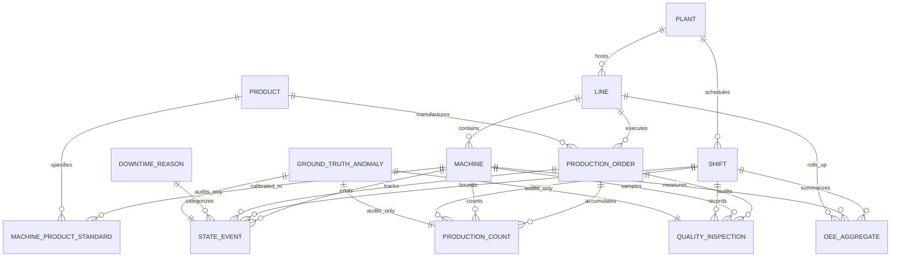

# Architecture Decision Document (ADD)
## Industrial OEE Analytics Engine & Synthetic Validation Framework

**Author**: Forward Deployed Engineer Candidate  
**Client / Challenge**: YottaFlex AI 72-Hour Engineering Assessment  
**Date**: October 2026  
**Status**: APPROVED & LOCKED  

---

## 1. Executive Summary & Architectural Scope
This document records the finalized architectural decisions, mathematical specifications, entity definitions, and boundary conditions for the YottaFlex AI Industrial OEE Analytics Engine. It incorporates all user adjustments following the Phase 1 specification review.

The primary objective is to implement an end-to-end, deterministic, auditable manufacturing analytics engine that generates master and transactional datasets, injects five isolated edge cases, validates data integrity across 15 distinct rules, and calculates Shift $\times$ Machine $\times$ Order OEE metrics without data leakage.

---

## 2. Entity Relationship Diagram (ERD)

The domain consists of 12 distinct relational entities, strictly partitioned between master data and transactional telemetry streams, alongside an isolated ground-truth anomaly registry.

---

## 3. Final Data Dictionary

### 3.1 Master Data Entities
1. **`plants`**
   - `plant_id` (`VARCHAR(16)`, PK): Format `PLANT-XX`
   - `name` (`VARCHAR(64)`): Operational facility label
   - `timezone` (`VARCHAR(32)`): Operating timezone (e.g., `UTC`)
   - `country` (`VARCHAR(3)`): Country code (ISO 3166-1 alpha-3)

2. **`lines`**
   - `line_id` (`VARCHAR(16)`, PK): Format `LINE-XX`
   - `plant_id` (`VARCHAR(16)`, FK $\rightarrow$ `plants.plant_id`)
   - `name` (`VARCHAR(64)`): Production line designation
   - `line_type` (`VARCHAR(32)`): Enum (`MACHINING`, `ASSEMBLY`, `PACKAGING`)

3. **`machines`**
   - `machine_id` (`VARCHAR(24)`, PK): Format `MCH-<line_id>-XX`
   - `line_id` (`VARCHAR(16)`, FK $\rightarrow$ `lines.line_id`)
   - `name` (`VARCHAR(64)`): Machine name / station designation
   - `sequence_order` (`INTEGER`): Physical sequence position ($\ge 1$)
   - `criticality` (`VARCHAR(16)`): Enum (`HIGH`, `MEDIUM`, `LOW`)

4. **`shifts`**
   - `shift_id` (`VARCHAR(32)`, PK): Format `SHIFT-YYYY-MM-DD-X`
   - `plant_id` (`VARCHAR(16)`, FK $\rightarrow$ `plants.plant_id`)
   - `shift_code` (`VARCHAR(8)`): Enum (`SHIFT_A`, `SHIFT_B`, `SHIFT_C`)
   - `start_time` (`TIMESTAMP`): ISO 8601 UTC
   - `end_time` (`TIMESTAMP`): ISO 8601 UTC ($> \text{start\_time}$)
   - `planned_break_sec` (`INTEGER`): Total planned break duration in seconds (e.g., `3600`)

5. **`products`**
   - `product_id` (`VARCHAR(16)`, PK): Format `PRD-XXXX`
   - `sku` (`VARCHAR(32)`): Unique Stock Keeping Unit code
   - `name` (`VARCHAR(64)`): Commercial product label
   - `family` (`VARCHAR(32)`): Product family / category

6. **`machine_product_standards`**
   - `standard_id` (`VARCHAR(48)`, PK): Format `STD-<machine_id>-<product_id>`
   - `machine_id` (`VARCHAR(24)`, FK $\rightarrow$ `machines.machine_id`)
   - `product_id` (`VARCHAR(16)`, FK $\rightarrow$ `products.product_id`)
   - `ideal_cycle_time_sec` (`DECIMAL(8,3)`): Engineering standard takt time ($> 0.000$)

### 3.2 Transactional & Telemetry Entities
7. **`production_orders`**
   - `order_id` (`VARCHAR(24)`, PK): Format `PO-YYYY-NNNNNN`
   - `product_id` (`VARCHAR(16)`, FK $\rightarrow$ `products.product_id`)
   - `line_id` (`VARCHAR(16)`, FK $\rightarrow$ `lines.line_id`)
   - `target_quantity` (`INTEGER`): Target batch size ($> 0$)
   - `scheduled_start` (`TIMESTAMP`): Planned start
   - `scheduled_end` (`TIMESTAMP`): Planned finish
   - `status` (`VARCHAR(16)`): Enum (`PLANNED`, `IN_PROGRESS`, `COMPLETED`, `CANCELLED`)

8. **`state_events`**
   - `event_id` (`VARCHAR(36)`, PK): Format `EVT-<machine_id>-NNNNNN`
   - `machine_id` (`VARCHAR(24)`, FK $\rightarrow$ `machines.machine_id`)
   - `shift_id` (`VARCHAR(32)`, FK $\rightarrow$ `shifts.shift_id`)
   - `order_id` (`VARCHAR(24)`, FK $\rightarrow$ `production_orders.order_id`, Nullable)
   - `state` (`VARCHAR(24)`): Enum (`RUNNING`, `UNPLANNED_DOWNTIME`, `PLANNED_DOWNTIME`, `CHANGEOVER`, `STARVED`, `BLOCKED`, `OFF`)
   - `start_time` (`TIMESTAMP`): Start of interval
   - `end_time` (`TIMESTAMP`): End of interval ($\ge \text{start\_time}$)
   - `duration_sec` (`INTEGER`): `end_time - start_time`
   - `reason_code` (`VARCHAR(32)`, FK $\rightarrow$ `downtime_reasons.reason_code`, Nullable)

9. **`production_counts`**
   - `count_id` (`VARCHAR(40)`, PK): Format `CNT-<order_id>-NNNNNN`
   - `order_id` (`VARCHAR(24)`, FK $\rightarrow$ `production_orders.order_id`)
   - `machine_id` (`VARCHAR(24)`, FK $\rightarrow$ `machines.machine_id`)
   - `shift_id` (`VARCHAR(32)`, FK $\rightarrow$ `shifts.shift_id`)
   - `timestamp` (`TIMESTAMP`): Pulse timestamp
   - `count_delta` (`INTEGER`): Units produced in pulse ($> 0$ or negative on correction)
   - `cumulative_count` (`INTEGER`): Running cumulative tally
   - `is_correction` (`BOOLEAN`): True if audit adjustment
   - `correction_ref_id` (`VARCHAR(40)`, FK $\rightarrow$ `production_counts.count_id`, Nullable)

10. **`quality_inspections`**
    - `inspection_id` (`VARCHAR(24)`, PK): Format `QC-YYYY-NNNNNN`
    - `order_id` (`VARCHAR(24)`, FK $\rightarrow$ `production_orders.order_id`)
    - `machine_id` (`VARCHAR(24)`, FK $\rightarrow$ `machines.machine_id`)
    - `shift_id` (`VARCHAR(32)`, FK $\rightarrow$ `shifts.shift_id`)
    - `timestamp` (`TIMESTAMP`): Inspection audit time
    - `inspection_type` (`VARCHAR(24)`): Enum (`FIRST_PIECE`, `IN_PROCESS`, `FINAL`)
    - `inspected_qty` (`INTEGER`): Sample size audited
    - `passed_qty` (`INTEGER`): Conforming units
    - `scrap_qty` (`INTEGER`): Non-conforming discarded units
    - `rework_qty` (`INTEGER`): Salvageable units
    - `defect_code` (`VARCHAR(32)`, Nullable)

11. **`downtime_reasons`**
    - `reason_code` (`VARCHAR(32)`, PK): Format `DT-<CAT>-<CODE>`
    - `category` (`VARCHAR(24)`): Enum (`PLANNED`, `UNPLANNED`, `CHANGEOVER`, `LINE_STOP`)
    - `description` (`VARCHAR(128)`): Root-cause description
    - `affects_availability` (`BOOLEAN`): Flag indicating if stoppage reduces availability

### 3.3 Output & Ground Truth Entities
12. **`oee_aggregates`**
    - `aggregate_id` (`VARCHAR(64)`, PK): Format `OEE-<shift_id>-<machine_id>`
    - `shift_id` (`VARCHAR(32)`, FK $\rightarrow$ `shifts.shift_id`)
    - `machine_id` (`VARCHAR(24)`, FK $\rightarrow$ `machines.machine_id`)
    - `line_id` (`VARCHAR(16)`, FK $\rightarrow$ `lines.line_id`)
    - `planned_prod_time_sec` (`INTEGER`): Planned Production Time in seconds
    - `operating_time_sec` (`INTEGER`): Actual Running time in seconds
    - `unplanned_downtime_sec` (`INTEGER`): Total unplanned downtime in seconds
    - `planned_downtime_sec` (`INTEGER`): Total scheduled break time in seconds
    - `total_count` (`INTEGER`): Total gross production count
    - `good_count` (`INTEGER`): Net good count (`total_count - scrap_count`)
    - `scrap_count` (`INTEGER`): Total scrap
    - `rework_count` (`INTEGER`): Total rework
    - `ideal_cycle_time_sec` (`DECIMAL(8,3)`): Effective ideal cycle time
    - `availability` (`DECIMAL(6,4)`): Availability ratio $[0.0, 1.0]$
    - `performance` (`DECIMAL(6,4)`): Performance ratio $[0.0, 2.0]$
    - `quality` (`DECIMAL(6,4)`): Quality ratio $[0.0, 1.0]$
    - `oee` (`DECIMAL(6,4)`): Composite OEE $[0.0, 1.0]$

13. **`ground_truth` (External Registry)**
    - `anomaly_id` (`VARCHAR(32)`, PK): Format `ANOM-NNNNNN`
    - `anomaly_type` (`VARCHAR(32)`): Anomaly classification
    - `table_name` (`VARCHAR(32)`): Corrupted file/entity
    - `record_id` (`VARCHAR(48)`): Primary key of mutated row
    - `related_record_id` (`VARCHAR(48)`, Nullable): Conflicting peer record ID
    - `field_name` (`VARCHAR(32)`): Column containing injected anomaly
    - `injected_value` (`VARCHAR(64)`): Injected anomalous value
    - `expected_value` (`VARCHAR(64)`): Expected valid value
    - `detection_rule_id` (`VARCHAR(16)`): Corresponding validator rule ID

---

## 4. OEE Formulas & Mathematical Derivations

### 4.1 Challenge Requirements vs. Implementation Assumptions
- **[EXPLICIT REQUIREMENT]**: Calculate Availability, Performance, Quality, and OEE by shift from machine-state events, production counts, quality inspections, and downtime information.
- **[EXPLICIT REQUIREMENT]**: Handle downtime overlapping planned breaks without silently corrupting unrelated records.
- **[EXPLICIT REQUIREMENT]**: Deterministic arithmetic reconciliation between raw source records and derived metrics.
- **[ASSUMPTION] Planned Production Time (PPT) Definition**:
  Standard shift duration is 8 hours (28,800s). Planned break time (scheduled lunch/tea breaks) is deducted from Shift Duration to establish the time the equipment is intended to run:
  $$\text{Planned Production Time (PPT)} = \text{Shift Duration} - \text{Planned Break Time}$$
- **[ASSUMPTION] Changeover Treatment**:
  Product changeover/setup time is treated as operational setup loss and penalizes Availability (derived from common discrete manufacturing practice, referenced in SEMI E10/ISO 22400 guidelines, but adopted strictly as an engineering design choice).

### 4.2 Mathematical Formulas
1. **Availability ($A$)**:
   $$\text{Operating Time (OT)} = \sum \text{duration of RUNNING state events}$$
   $$A = \frac{\text{Operating Time}}{\text{Planned Production Time}}$$
   *Boundary Guard*: If $\text{PPT} = 0$, $A = 1.0000$. Standard clean range: $0.0 \le A \le 1.0$.

2. **Performance ($P$)**:
   $$\text{Net Operating Time} = \sum_{i} \left(\text{Count}_i \times \text{IdealCycleTime}_i\right)$$
   $$P = \frac{\text{Net Operating Time}}{\text{Operating Time}} = \frac{\text{Total Count} \times \text{ICT}}{\text{Operating Time}}$$
   *Boundary Guard*: If $\text{Operating Time} = 0$, $P = 0.0000$. If $P > 1.20$, an operational or data anomaly is triggered.

3. **Quality ($Q$)**:
   $$\text{Good Count} = \text{Total Count} - \text{Scrap Count}$$
   $$Q = \frac{\text{Good Count}}{\text{Total Count}}$$
   *Boundary Guard*: If $\text{Total Count} = 0$, $Q = 1.0000$. Clean range: $0.0 \le Q \le 1.0$.

4. **Overall Equipment Effectiveness ($OEE$)**:
   $$OEE = A \times P \times Q$$
   *Direct Mass-Energy Identity Check*:
   $$OEE = \frac{\text{Good Count} \times \text{Ideal Cycle Time}}{\text{Planned Production Time}}$$
   *Equivalence Constraint*: $|(A \times P \times Q) - \frac{\text{Good Count} \times \text{ICT}}{\text{PPT}}| \le 10^{-6}$.

---

## 5. Downtime Classification Matrix

| Machine State | Downtime Reason Category | Included in Shift? | Included in PPT? | Impact on OEE |
| :--- | :--- | :--- | :--- | :--- |
| `PLANNED_DOWNTIME` | `PLANNED` (Lunch, Tea, Scheduled PM) | Yes | **No (Deducted)** | **Neutral** (does not reduce $A$) |
| `UNPLANNED_DOWNTIME` | `UNPLANNED` (Breakdown, Jam, Motor Trip) | Yes | **Yes** | **Penalizes $A$** |
| `CHANGEOVER` | `CHANGEOVER` (Die/Tooling Swap, Setup) | Yes | **Yes** | **Penalizes $A$** |
| `STARVED` | `LINE_STOP` (Upstream buffer empty) | Yes | **Yes** | **Penalizes $A$** |
| `BLOCKED` | `LINE_STOP` (Downstream buffer saturated) | Yes | **Yes** | **Penalizes $A$** |
| `OFF` | `PLANT_CLOSED` (Facility holiday/closure) | No | **No** | **Excluded from analysis** |

---

## 6. Edge-Case Injection Catalog (5 Required Scenarios)

| ID | Edge Case Scenario | Injection Mechanism | Affected Entity / Column | Target Detection Rule |
| :--- | :--- | :--- | :--- | :--- |
| **EC-01** | **Overlapping Machine States** | Shift $\text{start\_time}$ of event $i+1$ to be 15 min earlier than $\text{end\_time}$ of event $i$. | `state_events.start_time` | `VAL-TIME-002` (State Overlap) |
| **EC-02** | **Count Decrease Without Correction** | Decrement `cumulative_count` by 100 units with `is_correction = FALSE` and `correction_ref_id = NULL`. | `production_counts.cumulative_count` | `VAL-COUNT-001` (Illegal Decrement) |
| **EC-03** | **Scrap Exceeds Total** | Set `scrap_qty = inspected_qty + 15` in an inspection record. | `quality_inspections.scrap_qty` | `VAL-QUAL-001` (Scrap Overflow) |
| **EC-04** | **Wrong Ideal Cycle Time** | Substitute standard cycle time with an order-of-magnitude erroneous value (e.g. 0.3s instead of 6.0s). | `machine_product_standards.ideal_cycle_time_sec` | `VAL-PERF-001` (Cycle Time Discrepancy) |
| **EC-05** | **Downtime Overlaps Planned Break** | Schedule an unplanned breakdown overlapping a fixed shift lunch break without time partitioning. | `state_events` vs `shifts` | `VAL-TIME-003` (Break Collision) |

---

## 7. Validation Rule Catalog (15 Rules)

1. **`VAL-REL-001` (PK Uniqueness)**: Every primary key in every table must be strictly unique.
2. **`VAL-REL-002` (FK Referential Integrity)**: All foreign key references must resolve to an existing parent record.
3. **`VAL-REL-003` (Enum Domain Validity)**: Categorical fields must belong to authorized domain enums.
4. **`VAL-TIME-001` (Temporal Monotonicity)**: For every interval event, $\text{start\_time} \le \text{end\_time}$.
5. **`VAL-TIME-002` (State Mutual Exclusivity)**: No two state events on the same machine may overlap in time.
6. **`VAL-TIME-003` (Break Collision)**: Unplanned downtime events must not collide with or double-count scheduled shift break intervals.
7. **`VAL-COUNT-001` (Monotonic Counter Progression)**: Cumulative counts must not decrease unless explicitly flagged as a correction.
8. **`VAL-COUNT-002` (State-Authorized Pulse)**: Count increments must only occur while the machine is in the `RUNNING` state.
9. **`VAL-QUAL-001` (Quality Mass Balance)**: $\text{passed\_qty} + \text{scrap\_qty} + \text{rework\_qty} = \text{inspected\_qty}$ and $\text{scrap\_qty} \le \text{inspected\_qty}$.
10. **`VAL-PERF-001` (Standard Cycle Time Adherence)**: Cycle times used in calculations must match `machine_product_standards`.
11. **`VAL-PERF-002` (Performance Plausibility)**: Flag warnings/anomalies when $P > 1.20$.
12. **`VAL-OEE-001` (OEE Mathematical Reconciliation)**: $|OEE - (A \times P \times Q)| \le 10^{-6}$.
13. **`VAL-OEE-002` (Mass-Energy Direct Equivalence)**: $|OEE - \frac{\text{Good Count} \times \text{ICT}}{\text{PPT}}| \le 10^{-6}$.
14. **`VAL-OEE-003` (Metric Range Sanity)**: $0.0 \le A \le 1.0$, $0.0 \le Q \le 1.0$, $0.0 \le OEE \le 1.0$.
15. **`VAL-DUP-001` (De-duplication Audit)**: Zero duplicate transactions across all event files.

---

## 8. Reproducibility Strategy
- **Master Random Seed**: Configurable via `--seed` (default: `42`).
- **PRNG Isolation**: All stochastic decisions use dedicated, isolated PRNG instances (`random.Random(seed)` and `numpy.random.default_rng(seed)`).
- **Deterministic Row Ordering**: Datasets are sorted by deterministic natural keys (`machine_id`, `start_time`, `order_id`, `count_id`) before sequential ID assignment and CSV export.
- **SHA-256 Checksum Manifest**: Every run outputs `manifest.json` containing table row counts and SHA-256 hashes. Rerunning with the same seed guarantees identical checksums.

---

## 9. Assumptions Matrix
1. **24/7 Continuous Operation**: Shifts run 3 shifts/day $\times$ 8 hours/shift $\times$ 90 days = 270 shifts per plant.
2. **Planned Break Structure**: Each 8-hour shift contains 60 minutes of planned break time (deducted from PPT).
3. **Changeover Classification**: Changeover between orders is treated as Availability loss.
4. **Scrap vs Rework**: Scrap is deducted from total count; rework is tracked for quality audits but salvaged within the shift unless scrapped.
5. **Micro-Stops**: Short stops ($< 2$ min) are not recorded as discrete downtime events; they naturally manifest as speed loss in Performance ($P$).

---

## 10. Optional Enhancements
- **Polars Vectorized Aggregation**: Leveraging Polars for sub-second OEE calculation over 500k+ rows.
- **Rich Interactive Terminal Output**: Formatted tables, colorized rule verdicts, and progress indicators.
- **Automated Anomaly Detection Scorer**: Standalone benchmark evaluating validator findings against `ground_truth.json` (calculating Precision, Recall, and F1-score).

---

## 11. Validation, OEE Calculation & Benchmark Architecture (Phase 4)

### 11.1 Multi-Rule Validation Engine Architecture
The validation engine operates as an independent, blind evaluation harness:
- **Blind Execution Guarantee**: The engine loads raw CSV files from disk, explicitly filtering out any `ground_truth` files. It possesses zero dependency, import, or reference to `ground_truth.json`, `ground_truth.csv`, or anomaly injector internals.
- **Rule Execution Model**: Each rule inherits from `BaseValidationRule` and operates as an isolated validator over the Polars dataframes. Rules inspect relational, temporal, counter, mass-balance, and physical thresholds.
- **Structured Findings**: Violations emit a standardized `RuleFinding` detailing `rule_id`, `severity`, `table_name`, `record_id`, `field_name`, `message`, `observed_value`, and `expected_condition`.

### 11.2 Shift-Level OEE Calculation Flow
1. **Planned Production Time (PPT)**:
   $$\text{PPT} = \text{Shift Duration} - \text{Planned Breaks} = 28,800\text{s} - 3,600\text{s} = 25,200\text{s}$$
2. **Operating Time (OT)**:
   $$\text{OT} = \sum \text{duration of RUNNING state events within shift on machine}$$
3. **Availability ($A$)**:
   $$A = \frac{\text{OT}}{\text{PPT}}$$
4. **Performance ($P$)**:
   $$P = \frac{\sum (\text{Count}_i \times \text{IdealCycleTime}_i)}{\text{OT}}$$
5. **Quality ($Q$)**:
   $$Q = \frac{\text{Total Count} - \text{Scrap Count}}{\text{Total Count}}$$
6. **Composite OEE**:
   $$\text{OEE} = A \times P \times Q$$

### 11.3 Aggregation Grain
- **Grain**: Shift $\times$ Machine (with Line context).
- **Multi-Product Handling**: Production runs with multiple SKUs within a single shift compute a production-weighted average standard cycle time:
  $$\text{ICT}_{\text{eff}} = \frac{\sum (\text{Count}_i \times \text{ICT}_i)}{\sum \text{Count}_i}$$
- **Downtime Treatment**:
  - `PLANNED_DOWNTIME`: Scheduled breaks (60 min/shift). Deducted from Shift Duration, zero penalty on Availability.
  - `UNPLANNED_DOWNTIME`, `CHANGEOVER`, `STARVED`, `BLOCKED`: Included in PPT, penalize Availability.
  - Micro-stops: Reduce production rate within RUNNING time, penalize Performance.

### 11.4 Analytical Equivalence Identity Verification
The engine verifies analytical equivalence on every calculated aggregate:
$$|(A \times P \times Q) - \frac{\text{Good Count} \times \text{ICT}_{\text{eff}}}{\text{PPT}}| \le 10^{-6}$$
Across all 54 shift-machine rollups in the starter profile, the maximum observed deviation was $1.11 \times 10^{-16}$, demonstrating exact floating-point identity adherence.

### 11.5 Ground Truth Benchmark Separation
- The `GroundTruthBenchmark` class resides in a separate package (`src/yotta_oee/evaluator/benchmark.py`).
- It is the sole component that consumes `ground_truth.json` for scoring.
- It matches validator findings to ground truth records by `(table_name, record_id, rule_id)` and computes Precision, Recall, and F1-score.

### 11.6 Known Limitations
1. **Micro-Stops Resolution**: Stoppages under 2 minutes are not recorded as individual state events due to event log volume; they are accounted for in speed loss reducing Performance.
2. **In-Flight Orders Across Shifts**: Orders spanning multiple shifts split production counts and operating times cleanly by shift boundary based on sensor timestamp.

