# YottaFlex Industrial Manufacturing OEE Data Dictionary

This document serves as the authoritative data dictionary for the YottaFlex Industrial OEE Analytics Engine. It defines the schemas, data types, nullability, keys, constraints, units, and cardinality for all 12 domain entities, derived directly from the Pydantic domain models in `src/yotta_oee/domain/models.py` and enums in `src/yotta_oee/domain/enums.py`.

---

## 1. Entity-Relationship (ER) Diagram

```mermaid
erDiagram
    PLANTS ||--o{ LINES : "contains (1:N)"
    PLANTS ||--o{ SHIFTS : "schedules (1:N)"
    LINES ||--o{ MACHINES : "comprises (1:N)"
    LINES ||--o{ PRODUCTION_ORDERS : "executes (1:N)"
    LINES ||--o{ OEE_AGGREGATES : "attributes (1:N)"
    MACHINES ||--o{ MACHINE_PRODUCT_STANDARDS : "calibrates (1:N)"
    PRODUCTS ||--o{ MACHINE_PRODUCT_STANDARDS : "defines (1:N)"
    PRODUCTS ||--o{ PRODUCTION_ORDERS : "manufactures (1:N)"
    SHIFTS ||--o{ STATE_EVENTS : "bounds (1:N)"
    MACHINES ||--o{ STATE_EVENTS : "emits (1:N)"
    PRODUCTION_ORDERS ||--o{ STATE_EVENTS : "tracks (1:N)"
    PRODUCTION_ORDERS ||--o{ PRODUCTION_COUNTS : "measures (1:N)"
    MACHINES ||--o{ PRODUCTION_COUNTS : "pulses (1:N)"
    SHIFTS ||--o{ PRODUCTION_COUNTS : "tallies (1:N)"
    PRODUCTION_COUNTS ||--o{ PRODUCTION_COUNTS : "corrects (0:1)"
    PRODUCTION_ORDERS ||--o{ QUALITY_INSPECTIONS : "audits (1:N)"
    MACHINES ||--o{ QUALITY_INSPECTIONS : "inspects (1:N)"
    SHIFTS ||--o{ QUALITY_INSPECTIONS : "samples (1:N)"
    SHIFTS ||--o{ OEE_AGGREGATES : "rolls_up (1:N)"
    MACHINES ||--o{ OEE_AGGREGATES : "aggregates (1:N)"

    PLANTS {
        string plant_id PK "Format: PLANT-\\d{2}"
        string name "Facility Name"
        string timezone "IANA Timezone (UTC default)"
        string country "ISO Alpha-3 (e.g. USA)"
    }

    LINES {
        string line_id PK "Format: LINE-\\d{2}"
        string plant_id FK "References plants.plant_id"
        string name "Production Line Name"
        string line_type "Enum: MACHINING, ASSEMBLY, PACKAGING"
    }

    MACHINES {
        string machine_id PK "Format: MCH-LINE-\\d{2}-\\d{2}"
        string line_id FK "References lines.line_id"
        string name "Machine Tag"
        integer sequence_order "Sequential station index >= 1"
        string criticality "Enum: HIGH, MEDIUM, LOW"
    }

    PRODUCTS {
        string product_id PK "Format: PRD-\\d{4}"
        string sku "Stock Keeping Unit"
        string name "Product Catalog Title"
        string family "Product Family / Category"
    }

    SHIFTS {
        string shift_id PK "Format: SHIFT-\\d{4}-\\d{2}-\\d{2}-[A-C]"
        string plant_id FK "References plants.plant_id"
        string shift_code "Enum: SHIFT_A, SHIFT_B, SHIFT_C"
        datetime start_time "ISO 8601 UTC Start"
        datetime end_time "ISO 8601 UTC End"
        integer planned_break_sec "Scheduled break deduction (sec)"
    }

    MACHINE_PRODUCT_STANDARDS {
        string standard_id PK "Format: STD-MCH-LINE-XX-YY-PRD-ZZZZ"
        string machine_id FK "References machines.machine_id"
        string product_id FK "References products.product_id"
        float ideal_cycle_time_sec "Engineering takt time (seconds > 0)"
    }

    DOWNTIME_REASONS {
        string reason_code PK "Format: DT-[A-Z]+-[A-Z0-9_]+"
        string category "Enum: PLANNED, UNPLANNED, CHANGEOVER, LINE_STOP"
        string description "Stoppage root cause description"
        boolean affects_availability "True if stoppage penalizes Availability"
    }

    PRODUCTION_ORDERS {
        string order_id PK "Format: PO-\\d{4}-\\d{6}"
        string product_id FK "References products.product_id"
        string line_id FK "References lines.line_id"
        integer target_quantity "Planned target unit count > 0"
        datetime scheduled_start "Scheduled start timestamp"
        datetime scheduled_end "Scheduled completion timestamp"
        string status "Enum: PLANNED, IN_PROGRESS, COMPLETED, CANCELLED"
        float planned_cycle_time_sec "Order-level nominal cycle time (sec)"
    }

    STATE_EVENTS {
        string event_id PK "Format: EVT-MCH-LINE-\\d{2}-\\d{2}-\\d{6}"
        string machine_id FK "References machines.machine_id"
        string shift_id FK "References shifts.shift_id"
        string order_id FK "References production_orders.order_id (nullable)"
        string state "Enum: RUNNING, UNPLANNED_DOWNTIME, PLANNED_DOWNTIME, CHANGEOVER, STARVED, BLOCKED, OFF"
        datetime start_time "ISO 8601 UTC interval start"
        datetime end_time "ISO 8601 UTC interval end"
        integer duration_sec "Duration in seconds (end - start)"
        string reason_code "Stoppage cause code (nullable)"
    }

    PRODUCTION_COUNTS {
        string count_id PK "Format: CNT-PO-\\d{4}-\\d{6}-\\d{6}"
        string order_id FK "References production_orders.order_id"
        string machine_id FK "References machines.machine_id"
        string shift_id FK "References shifts.shift_id"
        datetime timestamp "Pulse sensor timestamp"
        integer count_delta "Count increment (+delta or -delta for correction)"
        integer cumulative_count "Running cumulative tally >= 0"
        boolean is_correction "True if record reconciles a miscount"
        string correction_ref_id FK "References production_counts.count_id (nullable)"
    }

    QUALITY_INSPECTIONS {
        string inspection_id PK "Format: QC-\\d{4}-\\d{6}"
        string order_id FK "References production_orders.order_id"
        string machine_id FK "References machines.machine_id"
        string shift_id FK "References shifts.shift_id"
        datetime timestamp "Audit sample timestamp"
        string inspection_type "Enum: FIRST_PIECE, IN_PROCESS, FINAL"
        integer inspected_qty "Audit lot sample size > 0"
        integer passed_qty "First-pass good units >= 0"
        integer scrap_qty "Defective unrecoverable units >= 0"
        integer rework_qty "Salvaged units conforming post-rework >= 0"
        string defect_code "Enum: DIMENSIONAL_OUT_OF_SPEC, SURFACE_SCRATCH, BURR_CONTAMINATION, MATERIAL_VOIDS, PACKAGING_DAMAGE, TOOL_MARKING (nullable)"
    }

    OEE_AGGREGATES {
        string aggregate_id PK "Format: OEE-SHIFT-YYYY-MM-DD-[A-C]-MCH-LINE-XX-YY"
        string shift_id FK "References shifts.shift_id"
        string machine_id FK "References machines.machine_id"
        string line_id FK "References lines.line_id"
        integer planned_prod_time_sec "Planned Production Time (Shift - Breaks)"
        integer operating_time_sec "Operating Time (PPT - Stoppages)"
        integer unplanned_downtime_sec "Unplanned stoppage time (sec)"
        integer planned_downtime_sec "Scheduled break downtime (sec)"
        integer total_count "Total units produced in shift"
        integer good_count "Conforming good units (passed + rework)"
        integer scrap_count "Scrapped units in shift"
        integer rework_count "Reworked units in shift"
        float ideal_cycle_time_sec "Weighted ideal cycle time standard"
        float availability "Operating Time / PPT"
        float performance "(Total Count * ICT) / Operating Time"
        float quality "Good Count / Total Count"
        float oee "Availability * Performance * Quality"
        string status "Enum: CLEAN, FLAGGED, ANOMALOUS"
        integer exception_count "Total validator exceptions on shift"
    }
```

---

## 2. Table Schemas & Data Dictionaries

### 2.1 `plants` (Manufacturing Facilities)
- **Primary Key**: `plant_id`
- **Foreign Keys**: None
- **Cardinality**: 1 plant per installation profile.

| Column Name | Type | Nullable | Key | Constraints / Pattern | Units / Descriptions |
| :--- | :--- | :---: | :---: | :--- | :--- |
| `plant_id` | String | No | PK | Regex: `^PLANT-\d{2}$` | Facility identifier (e.g. `PLANT-01`) |
| `name` | String | No | - | Min: 1, Max: 64 chars | Facility name |
| `timezone` | String | No | - | Max: 32 chars (Default: `UTC`) | Operating timezone designation |
| `country` | String | No | - | Length: 2-3 chars (Default: `USA`) | Country code |

---

### 2.2 `lines` (Production Lines)
- **Primary Key**: `line_id`
- **Foreign Keys**: `plant_id` $\rightarrow$ `plants.plant_id`
- **Cardinality**: 1 Plant to $N$ Lines (Starter: 2 lines; Full: 5 lines).

| Column Name | Type | Nullable | Key | Constraints / Pattern | Units / Descriptions |
| :--- | :--- | :---: | :---: | :--- | :--- |
| `line_id` | String | No | PK | Regex: `^LINE-\d{2}$` | Production line identifier (e.g. `LINE-01`) |
| `plant_id` | String | No | FK | References `plants.plant_id` | Facility reference |
| `name` | String | No | - | Min: 1, Max: 64 chars | Production line designation |
| `line_type` | Enum | No | - | `LineType`: `MACHINING`, `ASSEMBLY`, `PACKAGING` | Functional line classification |

---

### 2.3 `machines` (Workstation Equipment)
- **Primary Key**: `machine_id`
- **Foreign Keys**: `line_id` $\rightarrow$ `lines.line_id`
- **Cardinality**: 1 Line to $N$ Machines (Starter: 3 machines/line = 6; Full: 6 machines/line = 30).

| Column Name | Type | Nullable | Key | Constraints / Pattern | Units / Descriptions |
| :--- | :--- | :---: | :---: | :--- | :--- |
| `machine_id` | String | No | PK | Regex: `^MCH-LINE-\d{2}-\d{2}$` | Unique machine station ID |
| `line_id` | String | No | FK | References `lines.line_id` | Line reference |
| `name` | String | No | - | Min: 1, Max: 64 chars | Machine equipment name |
| `sequence_order` | Integer | No | - | Value $\ge 1$ | Station flow sequence along line |
| `criticality` | Enum | No | - | `MachineCriticality`: `HIGH`, `MEDIUM`, `LOW` | Operational criticality index |

---

### 2.4 `products` (Product Catalog)
- **Primary Key**: `product_id`
- **Foreign Keys**: None
- **Cardinality**: Starter: 4 products; Full: 20 products.

| Column Name | Type | Nullable | Key | Constraints / Pattern | Units / Descriptions |
| :--- | :--- | :---: | :---: | :--- | :--- |
| `product_id` | String | No | PK | Regex: `^PRD-\d{4}$` | Product SKU identifier (e.g. `PRD-0001`) |
| `sku` | String | No | - | Min: 1, Max: 32 chars | Stock-keeping unit code |
| `name` | String | No | - | Min: 1, Max: 64 chars | Catalog title |
| `family` | String | No | - | Min: 1, Max: 32 chars | Product family / component group |

---

### 2.5 `shifts` (Operational Calendars)
- **Primary Key**: `shift_id`
- **Foreign Keys**: `plant_id` $\rightarrow$ `plants.plant_id`
- **Cardinality**: 1 Plant to $N$ Shifts (Starter: 3 days $\times$ 3 = 9; Full: 90 days $\times$ 3 = 270).

| Column Name | Type | Nullable | Key | Constraints / Pattern | Units / Descriptions |
| :--- | :--- | :---: | :---: | :--- | :--- |
| `shift_id` | String | No | PK | Regex: `^SHIFT-\d{4}-\d{2}-\d{2}-[A-C]$` | Shift calendar window ID |
| `plant_id` | String | No | FK | References `plants.plant_id` | Facility reference |
| `shift_code` | Enum | No | - | `ShiftCode`: `SHIFT_A`, `SHIFT_B`, `SHIFT_C` | Standard 8-hour shift label |
| `start_time` | DateTime | No | - | ISO 8601 UTC (`%Y-%m-%dT%H:%M:%SZ`) | Shift start timestamp |
| `end_time` | DateTime | No | - | ISO 8601 UTC, `end_time > start_time` | Shift conclusion timestamp |
| `planned_break_sec` | Integer | No | - | Value $\ge 0$ (Default: 3,600s = 60 min) | Scheduled non-working break deduction |

---

### 2.6 `machine_product_standards` (Engineering Standards)
- **Primary Key**: `standard_id`
- **Foreign Keys**: `machine_id` $\rightarrow$ `machines.machine_id`, `product_id` $\rightarrow$ `products.product_id`
- **Cardinality**: Unique per Machine $\times$ Product combination (Full: $30 \times 20 = 600$).

| Column Name | Type | Nullable | Key | Constraints / Pattern | Units / Descriptions |
| :--- | :--- | :---: | :---: | :--- | :--- |
| `standard_id` | String | No | PK | `STD-{machine_id}-{product_id}` | Engineering standard identifier |
| `machine_id` | String | No | FK | References `machines.machine_id` | Machine station reference |
| `product_id` | String | No | FK | References `products.product_id` | Product reference |
| `ideal_cycle_time_sec` | Float | No | - | Value $> 0.0$ (seconds) | Master takt time specification |

---

### 2.7 `downtime_reasons` (Root Cause Taxonomy)
- **Primary Key**: `reason_code`
- **Foreign Keys**: None
- **Cardinality**: 9 standard industrial stoppage taxonomy codes.

| Column Name | Type | Nullable | Key | Constraints / Pattern | Units / Descriptions |
| :--- | :--- | :---: | :---: | :--- | :--- |
| `reason_code` | String | No | PK | Regex: `^DT-[A-Z]+-[A-Z0-9_]+$` | Root cause code (e.g. `DT-UNPLANNED-JAM`) |
| `category` | Enum | No | - | `DowntimeCategory`: `PLANNED`, `UNPLANNED`, `CHANGEOVER`, `LINE_STOP` | Stoppage classification |
| `description` | String | No | - | Min: 1, Max: 128 chars | Root cause description |
| `affects_availability` | Boolean | No | - | True or False | Availability loss flag |

---

### 2.8 `production_orders` (Manufacturing Work Orders)
- **Primary Key**: `order_id`
- **Foreign Keys**: `product_id` $\rightarrow$ `products.product_id`, `line_id` $\rightarrow$ `lines.line_id`
- **Cardinality**: 1 Line to $N$ Orders (Full: 690 orders across 90 days).

| Column Name | Type | Nullable | Key | Constraints / Pattern | Units / Descriptions |
| :--- | :--- | :---: | :---: | :--- | :--- |
| `order_id` | String | No | PK | Regex: `^PO-\d{4}-\d{6}$` | Work order number |
| `product_id` | String | No | FK | References `products.product_id` | Target manufactured product |
| `line_id` | String | No | FK | References `lines.line_id` | Assigned production line |
| `target_quantity` | Integer | No | - | Value $> 0$ units | Order production volume target |
| `scheduled_start` | DateTime | No | - | ISO 8601 UTC | Scheduled production start |
| `scheduled_end` | DateTime | No | - | ISO 8601 UTC, `end > start` | Scheduled production finish |
| `status` | Enum | No | - | `OrderStatus`: `PLANNED`, `IN_PROGRESS`, `COMPLETED`, `CANCELLED` | Order lifecycle status |
| `planned_cycle_time_sec` | Float | No | - | Value $> 0.0$ (seconds) | Order planned nominal cycle time |

---

### 2.9 `state_events` (Machine Operational State Intervals)
- **Primary Key**: `event_id`
- **Foreign Keys**: `machine_id` $\rightarrow$ `machines.machine_id`, `shift_id` $\rightarrow$ `shifts.shift_id`, `order_id` $\rightarrow$ `production_orders.order_id` (nullable)
- **Cardinality**: Continuous timeline partition per machine-shift (Full: 120,124 events).

| Column Name | Type | Nullable | Key | Constraints / Pattern | Units / Descriptions |
| :--- | :--- | :---: | :---: | :--- | :--- |
| `event_id` | String | No | PK | Regex: `^EVT-MCH-LINE-\d{2}-\d{2}-\d{6}$` | Chronological event identifier |
| `machine_id` | String | No | FK | References `machines.machine_id` | Reporting machine |
| `shift_id` | String | No | FK | References `shifts.shift_id` | Shift window |
| `order_id` | String | Yes | FK | References `production_orders.order_id` | Active work order (null during break) |
| `state` | Enum | No | - | `MachineState`: `RUNNING`, `UNPLANNED_DOWNTIME`, `PLANNED_DOWNTIME`, `CHANGEOVER`, `STARVED`, `BLOCKED`, `OFF` | Mutually exclusive machine state |
| `start_time` | DateTime | No | - | ISO 8601 UTC | State interval begin timestamp |
| `end_time` | DateTime | No | - | ISO 8601 UTC, `end_time >= start_time` | State interval conclusion timestamp |
| `duration_sec` | Integer | No | - | Value $\ge 0$ seconds (`end_time - start_time`) | Total elapsed interval duration |
| `reason_code` | String | Yes | - | References `downtime_reasons.reason_code` | Stoppage cause (populated if downtime) |

---

### 2.10 `production_counts` (Sensor Telemetry Pulses)
- **Primary Key**: `count_id`
- **Foreign Keys**: `order_id` $\rightarrow$ `production_orders.order_id`, `machine_id` $\rightarrow$ `machines.machine_id`, `shift_id` $\rightarrow$ `shifts.shift_id`, `correction_ref_id` $\rightarrow$ `production_counts.count_id` (nullable)
- **Cardinality**: Full: 585,380 sensor pulse records (~72 pulses/machine-shift).

| Column Name | Type | Nullable | Key | Constraints / Pattern | Units / Descriptions |
| :--- | :--- | :---: | :---: | :--- | :--- |
| `count_id` | String | No | PK | Regex: `^CNT-PO-\d{4}-\d{6}-\d{6}$` | Pulse telemetry record ID |
| `order_id` | String | No | FK | References `production_orders.order_id` | Work order produced |
| `machine_id` | String | No | FK | References `machines.machine_id` | Counter sensor machine |
| `shift_id` | String | No | FK | References `shifts.shift_id` | Production shift |
| `timestamp` | DateTime | No | - | ISO 8601 UTC | Pulse emission timestamp |
| `count_delta` | Integer | No | - | Positive increment or negative correction | Net units produced during pulse window |
| `cumulative_count` | Integer | No | - | Value $\ge 0$ units | Running cumulative tally |
| `is_correction` | Boolean | No | - | True or False | True if manual/sensor reconciliation |
| `correction_ref_id` | String | Yes | FK | References `production_counts.count_id` | Prior pulse record ID reconciled |

---

### 2.11 `quality_inspections` (Quality Sample Audits)
- **Primary Key**: `inspection_id`
- **Foreign Keys**: `order_id` $\rightarrow$ `production_orders.order_id`, `machine_id` $\rightarrow$ `machines.machine_id`, `shift_id` $\rightarrow$ `shifts.shift_id`
- **Cardinality**: Exactly 2 quality audit samples per machine-shift (Full: 16,200 records).

| Column Name | Type | Nullable | Key | Constraints / Pattern | Units / Descriptions |
| :--- | :--- | :---: | :---: | :--- | :--- |
| `inspection_id` | String | No | PK | Regex: `^QC-\d{4}-\d{6}$` | Quality inspection audit identifier |
| `order_id` | String | No | FK | References `production_orders.order_id` | Audited work order |
| `machine_id` | String | No | FK | References `machines.machine_id` | Audited machine station |
| `shift_id` | String | No | FK | References `shifts.shift_id` | Shift audit interval |
| `timestamp` | DateTime | No | - | ISO 8601 UTC | Sample audit timestamp |
| `inspection_type` | Enum | No | - | `InspectionType`: `FIRST_PIECE`, `IN_PROCESS`, `FINAL` | Audit milestone classification |
| `inspected_qty` | Integer | No | - | Value $> 0$ units | Sample lot size (e.g. 20-50 units) |
| `passed_qty` | Integer | No | - | Value $\ge 0$ units | Conforming first-pass units |
| `scrap_qty` | Integer | No | - | Value $\ge 0$ units | Defective non-conforming scrap |
| `rework_qty` | Integer | No | - | Value $\ge 0$ units | Salvaged units conforming post-rework |
| `defect_code` | Enum | Yes | - | `DefectCode`: `DIMENSIONAL_OUT_OF_SPEC`, `SURFACE_SCRATCH`, `BURR_CONTAMINATION`, `MATERIAL_VOIDS`, `PACKAGING_DAMAGE`, `TOOL_MARKING` | Primary observed defect root cause |

---

### 2.12 `oee_aggregates` (Shift-Level Performance Analytics)
- **Primary Key**: `aggregate_id`
- **Foreign Keys**: `shift_id` $\rightarrow$ `shifts.shift_id`, `machine_id` $\rightarrow$ `machines.machine_id`, `line_id` $\rightarrow$ `lines.line_id`
- **Cardinality**: 1 record per Machine $\times$ Shift (Starter: 54; Full: 8,100).

| Column Name | Type | Nullable | Key | Constraints / Pattern | Units / Descriptions |
| :--- | :--- | :---: | :---: | :--- | :--- |
| `aggregate_id` | String | No | PK | `OEE-{shift_id}-{machine_id}` | Unique aggregate identifier |
| `shift_id` | String | No | FK | References `shifts.shift_id` | Shift window |
| `machine_id` | String | No | FK | References `machines.machine_id` | Machine station |
| `line_id` | String | No | FK | References `lines.line_id` | Line attribution |
| `planned_prod_time_sec` | Integer | No | - | Value $\ge 0$ seconds | Planned Production Time (Shift - Breaks) |
| `operating_time_sec` | Integer | No | - | Value $\ge 0$ seconds | Operating Time (PPT - Stoppages) |
| `unplanned_downtime_sec` | Integer | No | - | Value $\ge 0$ seconds | Unplanned stoppage duration |
| `planned_downtime_sec` | Integer | No | - | Value $\ge 0$ seconds | Scheduled break stoppage duration |
| `total_count` | Integer | No | - | Value $\ge 0$ units | Total parts produced in shift |
| `good_count` | Integer | No | - | Value $\ge 0$ units | Conforming parts (passed + rework) |
| `scrap_count` | Integer | No | - | Value $\ge 0$ units | Non-conforming scrap parts |
| `rework_count` | Integer | No | - | Value $\ge 0$ units | Conforming reworked parts |
| `ideal_cycle_time_sec` | Float | No | - | Value $> 0.0$ seconds | Weighted standard takt time |
| `availability` | Float | No | - | Range: $[0.0, 1.0]$ | Operating Time / PPT |
| `performance` | Float | No | - | Range: $\ge 0.0$ | (Total Count $\times$ ICT) / Operating Time |
| `quality` | Float | No | - | Range: $[0.0, 1.0]$ | Good Count / Total Count |
| `oee` | Float | No | - | Range: $[0.0, 1.0]$ | Availability $\times$ Performance $\times$ Quality |
| `status` | Enum | No | - | `AggregateStatus`: `CLEAN`, `FLAGGED`, `ANOMALOUS` | Data-quality integrity classification |
| `exception_count` | Integer | No | - | Value $\ge 0$ | Total validation violations on shift |

---

## 3. Enumeration Reference Guide

| Enum Class | Allowed Literal Values | Description |
| :--- | :--- | :--- |
| `ShiftCode` | `SHIFT_A`, `SHIFT_B`, `SHIFT_C` | Standard 8-hour shift designations |
| `LineType` | `MACHINING`, `ASSEMBLY`, `PACKAGING` | Manufacturing process taxonomy |
| `MachineCriticality` | `HIGH`, `MEDIUM`, `LOW` | Machine station criticality ranking |
| `OrderStatus` | `PLANNED`, `IN_PROGRESS`, `COMPLETED`, `CANCELLED` | Work order lifecycle states |
| `MachineState` | `RUNNING`, `UNPLANNED_DOWNTIME`, `PLANNED_DOWNTIME`, `CHANGEOVER`, `STARVED`, `BLOCKED`, `OFF` | Exclusive physical machine operational states |
| `DowntimeCategory` | `PLANNED`, `UNPLANNED`, `CHANGEOVER`, `LINE_STOP` | Stoppage category classifications |
| `InspectionType` | `FIRST_PIECE`, `IN_PROCESS`, `FINAL` | QC sampling milestone classifications |
| `DefectCode` | `DIMENSIONAL_OUT_OF_SPEC`, `SURFACE_SCRATCH`, `BURR_CONTAMINATION`, `MATERIAL_VOIDS`, `PACKAGING_DAMAGE`, `TOOL_MARKING` | Visual and dimensional defect codes |
| `AggregateStatus` | `CLEAN`, `FLAGGED`, `ANOMALOUS` | Shift OEE calculation confidence status |
| `AnomalyType` | `OVERLAPPING_STATE`, `UNEXPLAINED_COUNT_DROP`, `SCRAP_EXCEEDS_TOTAL`, `INVALID_CYCLE_TIME`, `BREAKDOWN_OVERLAPS_BREAK` | Challenge synthetic edge case categories |
